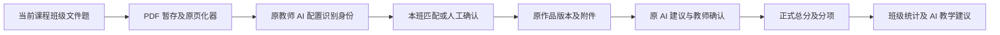

# 方案 A 实现设计

## 2026-09-20 V3.4与整班分段

`insight-v3.4.0`：原答以评分快照ID/评分项ID/作答位标签建立sourceKey，试卷Part.sourceKeys映射到实际原答；referenceStatus为CLEAR/DISPUTED/UNKNOWN，说明文字不再作为非空即争议的判断。无效原答、重复映射、页码越界保留不确定；成绩继续作为独立背景。

共享试卷解析后，已有SUCCESS证据优先复用，其他学生以最多6人且每批最多约60项知识诊断纯文本调用。每学生、每知识点独立校验，非法枚举/坏JSON不能拖垮同批其余学生；两批连续全无效暂停。可选具体错误归并短语无原文依据时剔除并提示核对，必需的状态、引用、原文差异和追问仍严格校验。局部结果标REVIEW，未提交或缺失证据不补零。教学活动基于后端聚合另调用一次。

PaperBatchImportService先保存原PDF并计页，不用最多50页的单人renderer读取整班。Redis原件24小时、教师及课程班级绑定；单页身份识别缓存，拆分先校验完整页段和本班唯一学生。固定方案hash与确定性子token支持重试；子Pending固定plannedStudentId，提交不能换人。已有权限、文件50MiB策略及原版本替换确认保持。

轮询只查询当前教师的过期任务ID，只有确实超过30分钟无进展才按主键条件更新，避免原全表超时UPDATE与后台写进度互锁。响应返回真实updatedAt。无业务SQL、新依赖或新配置；前后端配套与后端重启，旧报告按指纹保留。

## 2026-09-19 V3.3 四项修补

Part增加referenceIssue，Diagnosis增加correctEvidenceIds，ErrorDetail增加actualFragment/expectedFragment，版本指纹insight-v3.3.1。目录外模式仅按知识点、类别、原答/所选选项可核对的相同片段和正确片段归并，禁止只用选择字母；不同正确目标隔离，无法落到片段则保留个体观察。正确证据与错误证据互斥，均排除referenceIssue非空的作答位，对错并存归PARTIAL，CONFLICT仍需跨题可比依据且不得引用争议参考。

证据抽屉由相关题范围读取全部已存Evidence，不再只按diagnosis.evidenceIds裁剪。错误入口高亮当前错误；参考疑点入口固定题目/空位，原页优先定位该空位。首页疑点明细折叠，无新图或选题流程。旧报告可回看，新生成重新解析试卷。

争议空位可保留在诊断背景引用中，但不能进入correctEvidenceIds/errors；判定必须有无争议的清晰作答，MASTERED不可夹带争议/空白/不确定证据，CONFLICT须至少两道无争议清晰作答。避免因展示背景空位将整份有效诊断拒绝。

目录外同题错误按证据集合和具体差异去重，不再仅按题号加空patternId拒绝第二种错误；同题多错不构成跨题重复。纠正后校验失败记录固定校验原因（不记录答案或密钥），便于排查。

## 2026-09-18 学情 V3.2 两批优化

保留四阶段调用及原三表，提示词指纹升级为insight-v3.2。Question增加type/options/optionCount/codeContext/contextComplete/parts；Knowledge增加有试卷依据的errorPatterns；Diagnosis增加comparability和逐题errors（questionId/patternId/category/observedError/expectedApproach/causeHypothesis/verificationQuestion/evidenceIds）。参考答案不进入学生抄录阶段。

Engine拒绝漏空、重复空、缺选项的完整选择题、题目上下文不足却判掌握或错误、无逐题差异和验证问题的错因，以及无可比依据的矛盾。具体模式聚合人数，未匹配模式不强合并；错误模式有效分母由适用题可读证据及已证实犯错者确定，独立执行样本门槛。跨题重复看不同questionId，大量空白按整卷独立作答位至少半数判断。重点学生优先高分核心漏洞/矛盾/重复，其次空白缺证据，低分仅辅助。

PracticalInsightDrawer首屏短摘要，设置和细表折叠，三图主展示，成绩图折叠。共享证据抽屉根据knowledgeId/error/studentId定位诊断和相关学生，展示题干/选项/代码、逐空原答/参考及具体错因，自动打开第一条关联证据页；请求序号避免快速切换串学生图片。旧报告保留回看，新指纹使旧报告过期。没有新依赖或迁移SQL，后端需重打包重启，前端需配套。

学生诊断首次未通过业务校验时，将具体规则和原诊断交回模型纠正一次，复用既有逐空识别，不放宽证据校验。第二次仍不合格即停止该学生诊断；两次调用消耗均纳入原任务预算。参考材料与题干/代码矛盾时标记待教师核对，不修改参考答案或正式成绩。

## 2026-09-18 学情 V3 的 B 路线核心实现

新增PracticalInsightInputService/Engine/AiService/Worker/ReportService、固定DTO、Mapper及Controller。InputService在一致性只读快照中收集真实材料、年级、名单、正式成绩及作品；AiService先整卷后逐空识别/诊断，Engine校验引用并计算分母，Worker保存进度和可复用证据，ReportService负责范围授权和过期检测。模型JSON为Paper.questions/knowledgePoints、Recognition.evidence、Result.diagnoses、Teaching.activities四种，最终报告追加coverage/knowledgeStats/errorStats/studentMatrix/focusStudents/scoringStats。评分点仅最后追溯。

API基址`/business/teacher/grading/insight-v3`，create/latest、GET状态、cancel/retry、students/{id}及受保护页图。沿用后台执行器、ECharts和教师AI配置，无新依赖。默认关闭，迁移后三表与配套前后端启用；同教师当前单实例只允许一个活跃任务。最低10/.8不可配置放宽，累计Token费用达到20元默认软上限停止后续调用；超时未知费用不保证硬上限。UI当前宽幅抽屉为过渡，完整路线待办见tasks。

## 2026-09-18 学情诊断 MVP 实现

`PracticalClassInsightService` 在只读事务中计算正式成绩、评分点问题比例、学生画像和重点观察候选，并把题干、年级与证据覆盖状态放入 AI 输入。`PaperScanVisionGateway` 使用结构化 JSON 契约，明确模型只能解释服务端事实。`PracticalInsightDrawer` 通过页签展示班级概览、知识点候选、学生观察、教学安排和评分依据；旧缓存字段保留降级路径。整卷映射、逐空证据表和异步任务仍按后续设计实施。

## 2026-09-17 评分边界

teacher-paper 来源使用两阶段视觉评分：学生页独立识别，参考材料仅进入评分阶段。识别JSON随原AI evidence保存，无新表。空白/不确定保留待核对提示，但不排除批量采用；教师确认方式后按原版本校验、成绩写入及审计流程执行。详见 ../operation-artifact-ai-grading/ADR-007-paper-evidence-before-grading.md。

## 入口与接口

原 grading.vue 挂载 PaperImportDrawer / PracticalInsightDrawer。原扫描路由重定向原批改页。`/business/teacher/grading/paper-import/{roster,upload,submit}` 和 `/class-insight[/generate]` 均使用原教师/admin角色及课程班级范围校验。旧管理课程列表权限不适用于此入口。

## 数据流

暂存凭证 Redis 24 小时，教师/范围/学生绑定；专用目录超过 25 小时清理。PDF 由原文件策略校验，最多 50 MiB；教师适配允许 PDF 不改变学生上传格式限制。正式写入前锁内核对当前版本及预期分数，沿用原归档/转换/任务状态/批改期限逻辑。正式附件专用目录标记纸质来源。

学情在 REPEATABLE_READ 事务内读取本班有效学生当前版本正式成绩，正式零分保留；未确认、退回不计入均分，缺明细不补零。评分点按评分标准快照与项目 ID 分组。正式内容 SHA-256 指纹决定缓存，生成后再次核验；报告缓存 7 天。模型只接收汇总，不接收姓名，没有具体作答证据时不得编造典型错误。

## 运行与限制

2026-09-17 实测补充：暂存文件使用规范化绝对路径传给 MultipartFile.transferTo；页图资源映射同时规范化 profile 路径，避免 Tomcat 相对路径及 `./` 差异。身份模型接收当前授权班级的学号/姓名候选用于核对近形字，不凭学号盲选，最终仍由服务端严格双字段匹配。真实 3 页 PDF 在课程380导入成功（versionId=16403），后续评分/学情尚未执行。

无 SQL、无新依赖，后端资源变更需要 clean package 及重启，前后端配套。旧扫描 SQL 不执行。真实身份识别、导入写库、原 AI 评分和新学情生成尚未全链测试；当前只有真实只读接口、页面和模拟提交交互证据。
