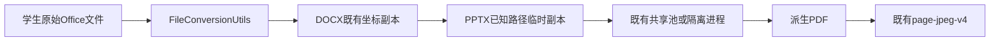

# PPTX预览兼容设计

130正式1.30.51已发布，四班40份PPTX重算及真实教师验收通过。默认代码回退保留已验证期限校正和正确预览，无需回滚SQL；只有数据本身确认有误时才按专题备份逐行恢复。

`FileConversionUtils`→既有DOCX预处理→`PptxPreviewNormalizer`→既有独立LibreOffice进程→PDF→既有页图v4。

只读取PPTX的`ppt/slides/slideN.xml`。已知straightConnector1/bentConnector2～5按DrawingML预设路径展开成普通custom geometry，脱离自动连接关系；原xfrm及样式保持。负调整值不能截断到0～100000，反馈作品的左右回路线依赖越界调整。公式依据本机Apache POI 5.2.3的`presetShapeDefinitions.xml`，使用原默认50000。

输入输出形状的单段文字在明确字号、无br、无wrap/vert/自动适应、框高不超过字号两倍时显式wrap=none，保留学生保存的单行；其余文字框不猜测。曲线、未知几何或非常量调整公式不转换。

XML禁用DOCTYPE/外部实体，单XML8MiB，包展开总量256MiB。失败退回原转换；临时副本保持原文件名，关闭后清理。原文件身份继续用于隔离、毒文件及重试。无新依赖、配置、表结构或页图版本升级。

新代码只影响后续转换，历史缓存需按附件精确备份后重算PDF与页图，校验原件哈希、答案成绩、版本指针不变。未知曲线、旧PPT和其他字体兼容仍不在本轮承诺范围。决策见[ADR-001](ADR-001-preserve-saved-paths.md)。
