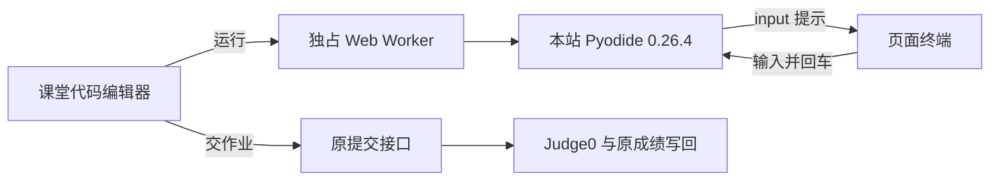

# 课堂 Python 交互运行设计

## 运行与计分边界

`InteractiveTerminal.vue` 展示连续输出和输入框；`interactiveRunner.js` 管理线程、请求编号与超时；`interactiveWorker.js` 复用 `/pyodide/` 基础运行库，仅覆盖 `builtins.input`，以 JSPI + `pyodide.ffi.run_sync` 挂起等待消息。学生原代码按 `main.py` 编译执行，不做正则拆代码、重跑前缀或 AST 异步改写。函数、别名和循环内的 `input()` 保留同步语义。

每次运行新建 Worker，结束、错误、停止、切题、卸载时销毁，忽略旧 Worker 消息。加载上限 180 秒；执行阶段 10 秒；等待输入单独允许 5 分钟，不计入执行阶段；回车后重新启动执行计时。UTF-8 输出上限 64KB，输入单次最多 4096 字符。以上属于浏览器调试保护，不替代 Judge0 的资源限制。

保持 stdout 片段原有换行，在输入响应恢复 Python 前回显学生输入。错误只显示 `main.py` 行号、代码和异常信息。草稿沿用原接口，修复原 `pendingDraft` 非 ref 却访问 `.value` 的问题；失败可手动重试，避免每 300ms 无限重试；切题与卸载后不接收旧请求结果。

## 兼容性与部署

- 要求浏览器提供 `WebAssembly.Suspending/promising`；缺失时给出可操作错误，不伪造运行成功。不要求 SharedArrayBuffer、COOP/COEP 或 HTTPS；原 HTTP 站点无需改安全头。
- 浏览器不持有 Judge0 凭据。Worker 是页面线程隔离，不是服务器级安全沙箱；浏览器调试结果不能用于计分。
- 不加载 pandas、matplotlib 等实验依赖；不新增 npm 包、SQL、后端接口或核心配置。`VITE_PYODIDE_BASE_URL` 沿用已有设置。
- 发布仅需新前端制品及既有 `/pyodide/` 资源可用；无需后端重启。回滚前端可恢复原输入方式，旧后端运行接口保留。
- 正式提交仍按既有 stdout 规则比较，`input("提示")` 的提示本身也属于 stdout；本次未修改输出比较器或题目测试数据。浏览器调试成功不能视为判题通过。
