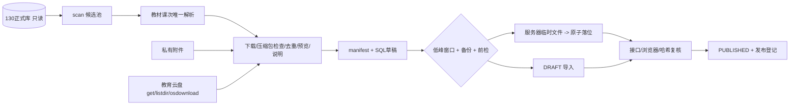

# 教研活动资源整理为电子教材与优秀课例：设计

状态：**2026-11-09 已随130正式release上线**；3节课例PUBLISHED，文件与接口权限已验证；三尺寸课例面板浏览器专项未单独留证。

## 流程

## 幂等与字段

`source_key='research-post-<post_id>'`；`research_post_id`唯一且允许旧数据NULL。`research_topic_title`保存活动标题快照；`origin='RESEARCH_ACTIVITY'`只用于来源标签，不复用旧枚举含义。资源键由`research-post:<post_id>:<文件SHA-256>`哈希得到，同内容跨私有ZIP和云盘根目录只上架一次，优先私有ZIP原件。

SQL分两层：仓库`sql/research_to_textbook_cases_v1.sql`是幂等DDL；本次run的`reports/import-draft.sql`是由manifest生成的DRAFT数据导入，执行前必须再次核对帖子更新时间。所有SQL不含DELETE，不写死目标库`case_id`。

## 文件与预览

来源文件下载到`output/research-case-import/<runId>/source/`，可独立展示的文档写入`extracted/`，PDF预览写入`previews/`。正式文件按`<sha256前两位>/<sha256><扩展名>`落在`shared/textbook/cases`，预览在`previews/`；先写`.staging/<runId>/.part`再改名，服务器再次执行`sha256sum -c`，禁止出现数据库已引用但文件半截的状态。

ZIP用Python `zipfile`读取并还原GBK/CP437文件名；RAR/7Z/TAR优先用`7z/bsdtar/tar`列目录和解到临时目录，只读取内容、不执行程序。`.py/.bat/.js/.url/.txt`及运行库、缓存、安装包不单独上架，保留原包；`requirements`只写教师需要的简短内容与操作提示（如启动哪个文件、需联网、其他资料在资源列表），技术清单留在检查报告，不写SHA-256、完整路径和内部程序明细。

Office预览用独立`UserInstallation`、独立临时目录、单进程和超时；转换失败只影响在线预览，不阻断原文件下载。后端`media`仅增加明确音频MIME白名单，继续沿用教师身份校验、Range和`private, no-store`。

## 后端与前端

`TextbookCaseMapper.cases`增加`researchTopicId/researchTopicTitle/researchPostId`；`TextbookCaseController.cases`仍只返回PUBLISHED，下载/预览/HTML沙箱权限不变。`CasePanel.vue`在折叠标题下显示完整活动标题，桌面省略、手机换行；`originLabel`增加`RESEARCH_ACTIVITY`；`previewTools`和下载标签按`ARCHIVE`分类及ZIP/RAR/7Z/TAR扩展名识别；音频资源使用原生`<audio>`并提供失败提示。

## 回退

优先按`source_key`（`research-post-15`、`research-post-60`、`research-post-70`）把新课例转回DRAFT，恢复旧前后端release；新增文件只按manifest精确清单处理，旧课例、资源、评价、备份和旧release保留。没有低峰窗口确认、备份SHA或验收通过证据时，不得PUBLISHED或登记发布。
