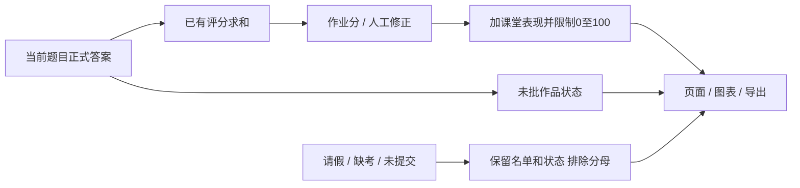

# 成绩汇总与打字显示设计

2026-10-17已按用户重新授权合并发布130正式1.30.52，双端`20261017_seat_score_v1`、助手0.2.4；真实教师/教研员验证及更新130/PUBLISHED通过，学生与机房仍待验。见[正式验收与回退](../seat-score-release-20261017.md)。

## 总分与状态分离

`BizStudentAnswerMapper`两个普通课汇总查询对已有score求和；仅关联课程当前题目，非空作品/有效版本的未批操作题产生`practicalPending`。操作分全部未批仍为NULL，部分已批则为已批合计，任何有效作品未批均保留标记。空占位仍不构成提交，0分仍已批。

`ScoreQueryController`保留`pendingGrading`/`practicalPending`提示事实，取消待批对总分和均分的阻断；请假/缺考/未提交继续排除。人工作业分修正优先；课程分按原规则夹在0～100内。Excel与页面使用同一批汇总事实，操作均分只纳入非NULL操作分。

Vue3成绩页先累计已有分数，课次平均纳入操作待批课程；不做权重重分配。没有有效课次时总分为NULL，单独返回`scoreStatus`。排名图直接接收全体名单，缺成绩者排末尾，只用0画占位，标签/提示显示状态；默认全量显示，保留缩放。排序不改原数组，同名学生通过索引匹配提示。课程对比图同样不排除操作待批。

## 打字最高记录

保留既有MySQL原子择优SQL及教师重做事务；`keepBestScore`在打字分支入口设置，覆盖空答案边界。交卷响应新增按题目ID映射的`typingResults`，仅返回本人请求题目的实际保存记录（分数、文本和三项指标）；`totalScore`继续表示本次请求对应的已保存合计。

当前课程响应给已提交答案补齐三项统计。学生状态用`bestScore`及对应指标保存计分事实，练习计时/输入与该事实分离；自主重打不清最高分，教师轮次改变沿用原清状态流程。读取历史速度不再用题目固定时长重算；交卷响应核对课程、轮次和状态对象，迟到响应不能复活已清旧轮。

无新表/索引/依赖/配置，无业务数据迁移。需要配套更新前后端并重启后端；回退应用即可，但旧版会恢复总分待批阻断和旧显示问题，不回灌数据库。
