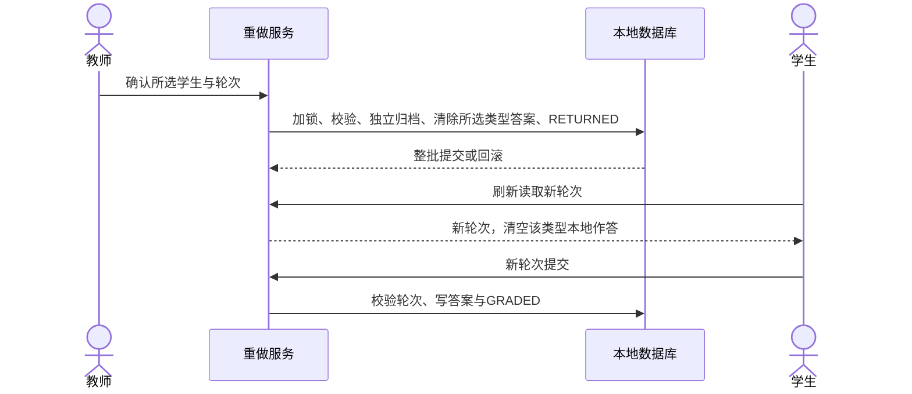

# 理论与打字重做设计

## 打字扩展与状态并发修复

`POST /business/score/theory-redo/typing`复用原请求和权限，studentRevisions在该接口表示打字轮次；查询增加hasTyping、每生typingRevision/typingAnswerCount。学生current-lesson和submit-answers独立携带typingRevision，两类轮次互不影响。

`sql/typing_redo_v1.sql`新增独立biz_typing_redo_history，保留打字原答、分数和统计快照；以最大redo_id为轮次，学生/课程/前轮唯一。教师重做与打字交卷共用学生及指派锁，归档/删除/RETURNED及答案/GRADED各自同事务。打字保留既有keepBestScore在本轮取最高分，教师清除当前答案后新轮可接受低分。操作题路径保留。学生读到新轮清空文本、计时器和状态，旧轮提交拒绝并刷新。

课堂状态：REPEATABLE_READ下首查为空、另一事务插入、同状态upsert不改变行时，普通SELECT仍读空快照。保留首查，upsert后selectOneForUpdate当前读获取真实记录。不锁定首次缺失行，避免增加间隙锁死锁风险；不改全局隔离级别或隐藏错误。

新环境必须先执行理论和打字两份SQL，再配套更新前后端并重启。无新配置或依赖；回退应用保留两张历史表，不自动覆盖回旧成绩。下述理论原设计中的“打字继续原路径”已由本节取代。

## 接口与权限

- `GET /business/score/theory-redo`：lessonId、entryYear、classCode，返回当前课程判断及每个学生revision/answerCount。
- `POST /business/score/theory-redo`：上述范围和studentRevisions映射，返回changedCount。沿用business:score:list且要求teacher/admin；业务层还核验本校课程指派与任教班级，管理员同样不绕过学生管理关系。
- 学生current-lesson返回theoryRevision；submit-answers传theoryRevision。首轮兼容缺省0，已重做必须提供正确轮次。

## 数据与事务

`sql/theory_redo_v1.sql`只新增biz_theory_redo_history。保存原答案、分数及理论题快照、教师、学校班级、前轮revision；redo_id最大值作为下一轮版本，(student_id,lesson_id,previous_revision)唯一约束防重。

重做按学生ID顺序锁学生，再锁最新有效课程指派；核验范围、当前课程、版本、人工改分后，在一个READ_COMMITTED事务中归档、删除理论答案、将原提交理论题状态置RETURNED。没有答案则跳过，不生成空历史。交卷共用学生与指派行锁，核验开关/版本/已有提交，答案及GRADED状态在同一事务提交。广播仅在提交后发送。打字和操作题继续原路径。

前端成绩查询/重做上下文丢弃过期响应；切换班级课程清除勾选，确认后再次校验范围。学生交卷成功使交卷前的查询失效，防止旧查询恢复未提交状态。

## 运行与回退

启动新后端之前执行建表SQL；current-lesson依赖新表，因此不能只更新前端或只重启后端而漏迁移。无需新增配置或依赖，前后端需配套。回退应用可保留历史表，不自动把旧成绩覆盖回去；已完成重做的业务数据需要按历史逐项审核恢复，不做整库覆盖。

本机备份、测试和剩余限制见tasks.md。正式环境完全未迁移、未发布。
