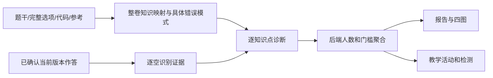

# 业务与权限边界

## 2026-10-07 并发与页面状态修复（130 正式 1.30.36）

区域抽测评卷的名单、详情、评分必须属于当前筛选与答卷；学生明细使用原服务端分页契约。成绩分析及答题矩阵只能呈现当前课程、班级、年份的响应。Python 题单保存和运行绑定题目/代码快照，跨题迟到结果不能改写当前题。整班 PDF 同原件拆分保持串行及幂等，不同原件可并行。只改变页面请求时序和服务内锁粒度，无接口、数据表、权限或既定评分规则变更；130 正式环境已发布，真实写入及整班并发仍待专项验收。

## 2026-10-05 登录页公开概览（正式1.30.28）

仅`GET /business/login-preview/activities`与`/lessons`允许匿名，固定最多3条主题、6条近90天有真实活动的课程班级，无详情ID、筛选或分页参数。SQL查询摘要并经Service显式白名单投影；不返回正文、附件/云盘、分享令牌、接收人、学生身份或具体成绩。发布学校/教师仅作为概览元信息，原教研主题、资源、监管与成绩详情继续执行原登录/角色/菜单/数据范围校验；本机及130正式匿名详情接口HTTP200/业务401已验。

主登录框只保留标题/账号/密码/登录按钮，验证码开关保持服务端决定，开启时提交后弹窗校验，不绕过后端验证；多校选择、学生/教师/教研员跳转保持。操作题待批为当前课题关联的非空已提交答案且score为NULL，0分已批，无提交不能标记全部批改完成。年级按真实使用当天换算，缺学段降级原入学年份。详见[设计](../../contexts/login-showrooms-20261005/design.md)、[ADR](../../contexts/login-showrooms-20261005/ADR-001-public-summary-only.md)与[验收](../../contexts/login-showrooms-20261005/verification.md)。无结构迁移，正式1.30.28已上线；仅SQL登记产品更新，证据见[正式验收](../../contexts/login-showrooms-20261005/release-verification.md)。

> 2026-10-03正式1.30.26：可选机位助手已开启，HTTP平台受支持；未注册/离线/撤销仅提示，教师显式确认长期机位，不限制登录和作答。无助手学生正式提交验证通过，原评分和当前课边界保持。见 [助手验收](../../contexts/classroom-experience-20261002/seat-helper-release-verification-20261003.md)。

> 2026-10-03正式1.30.24已上线（v4.02），先前本机候选描述转为历史；四份课堂SQL及厂商密钥依赖已迁移，正式API13组/浏览器9组通过。118条历史状态未治理，助手保持关闭、机房待验。见 [正式验收](../../contexts/classroom-experience-20261002/release-verification-20261003.md)。

> 2026-10-03 v4.01本机修复候选：删除未批文件作品同事务撤回提交事实和任务状态；空占位在反馈/成绩/导出为未提交，不计均分。0分锁定、当前课禁旧写、独立课堂表现/人工修正不变。流程图只读正式版，草稿按账号隔离。 证据与限制见 [修复验收](../../contexts/classroom-experience-20261002/repair-verification-20261003.md)，未正式发布。

## 2026-10-02 当前课堂作品与个人反馈（本机候选）

- FILE/FLOWCHART 的正式 score 为 NULL 时，学生可重复修改和提交；0 分已批、默认锁定。教师当前课已批后可退回，新提交成功才留旧版本/原分并清当前分，失败保持原分。AI 建议未确认不锁定；退回待重交拒绝人工评分与旧 AI 采用，提交评分核对同一版本。草稿、成功提交和已评分分别处理；推进后旧课禁止学生写入、教师退回，历史继续查看。Python、理论、打字原业务不改。
- 文件权限仍按本人或课程/班级教师授权；新 TXT/HTML/压缩包需具体题允许，旧题默认、参考上传与区域抽测不因本次扩展而自动放开。TXT/HTML ≤2MiB、单个非图片，TXT 永远文本；HTML 只在独立沙箱执行受限内联 CSS/JS，主页面不注入源码。压缩包只受权下载、不解压；三类新格式只人工批改，不进入转换失败重试或图像 AI。原 Word/PDF/多图预览保留。
- 学生反馈接口不接受目标学生 ID，由登录用户映射本人，区域抽测优先规则保持。正式成绩和评分项可读，参考内容仅在正式评分后提供。教师拥有本课/本班报告才可主动发布，发布前核对报告与当前证据未过期；只冻结各学生个人证据，没有全班报告/同学成绩。报告重试或重新生成不自动更新发布；新发布保留旧版，历史可读、作品变更标注来源版本。
- 机位助手仅管理员配置学校、注册/撤销设备；教师按现有班级授权查看、在当前课确认长期常用机位。全局和学校开关默认关闭；设备凭据、指纹、短时单次凭证与有效网页登录共同关联，同源登录本身不证明操作者。学校、机房、班级绑定隔离；缺席/未识别/同机多账号不覆盖基准。变化只提醒核实，不封禁账号、不阻断原课堂操作。
- 大屏“连接 IP”是服务端所见地址，“内网 IP”是可信助手心跳字段；IP 变化不直接等于换电脑。提交/已批绿色、退回红色与在线和理论独立，卡片布局/分组与长期机位分开。机房真实还原、自启与极域验证未完成，不能宣称全校部署通过。

规则、实际证据和上线限制见 [专题需求/设计](../../contexts/classroom-experience-20261002/requirements.md)、[验收记录](../../contexts/classroom-experience-20261002/verification.md) 与 ADR-001～003；下面冲突的旧阶段描述只作历史。

## 2026-09-23 本地候选：退回、画程、模型配置

2026-09-24 本机候选规则：班级推进后旧课立即停止学生提交，教师只能退回当前课，学生只能在当前课重交；取消15分钟补交窗口。文件新版本与画程新提交仍把当前成绩置为待批，旧版本和原成绩审计保留；旧 AI 结果因作品版本变化不能采用，陈旧修订号和跨班请求拒绝。画程只读提交先重开草稿再编辑。学生上传多张图片时，待上传文件也计入批次类型、顺序和数量校验。历史旧课退回状态只供查询，不再授权写入。

题库 `DATA_LAB` 新建/修改按钮沿用 `business:question:add/edit`；共用的 Excel 上传和实验配置接口允许题库 add/edit 或原 Python 题单 edit，读取允许 question:query 或原 pythonPractice:query。题单发布快照、学生实验授权和评分边界保持原规则。打字年级参数可选，清除后与旧统计条件一致。

AI 配置仅返回厂商、模型和 Key 掩码；空 Key 只复用同厂商已存密文，删除单个厂商后该厂商的旧任务不能改用别家 Key。创建时冻结厂商/模型/价格，所有 AI 建议仍由教师确认才写正式成绩。未知价格与免费额度不参与 0 元估价。本机接口和页面已验，外部厂商真实调用待有 Key 后验证；架构决定见操作题专题 ADR-008。

## 2026-09-23 题库实验题入口与打字统计年级条件（本机未发布）

数据分析实验题仍是 `practical/DATA_LAB`，题库管理直接调用现有编辑器；新建和编辑分别沿用 `business:question:add/edit`，题单仅负责引用已有题目，不改变发布快照或学生提交权限。打字统计沿用 `business:schoolScore:stats`；可选年级按查询学年换算学生入学年份并限定学校学段，同一条件同时用于学校汇总和班级明细，未选年级保持原均值口径。当前仅定向 Mapper 测试及 Vue3 构建通过，本地真实库数值与教师页面待验；详见 `contexts/dev-plan-20260923.md`。

## 2026-09-21 人工批改快照边界（130正式1.30.21）

发布证据见PROJECT_CORE v3.92及output/share-grading-release/。正式教师页面与模拟批改回归通过；分享真实跨设备操作待教研员凭据补验。以下本机验证记录保留为历史。

静默名单刷新不能切换当前学生或改变当前评分的作品/成绩基线。提交作废旧名单请求，保存后按答案身份更新并切人；检测到作品、成绩或评分依据变化时保留输入并锁住提交，由教师主动重载。后端并发改分保护继续生效，无SQL、接口或权限变化。9项时序测试、构建与模拟浏览器通过，真实成绩未写入；正式发布待办，详见操作题专题tasks及PROJECT_CORE v3.91。

## 2026-09-21 分享回显（本机待发布）

分享状态GET先校验管理权限及有效通知，仅当前有效链接可解密回显；读取不修改有效期或令牌。SHA-256继续服务匿名查询，新增AES-GCM密文仅供管理接口，普通主题JSON不返回。旧链接无密文时保持可用，主动重生成才失效；撤销同时清空哈希与密文。见教研ADR-006与ciphertext_v2迁移。

## 2026-09-20 整班PDF与学情复用

整班PDF仅保存暂存原件；校验教师/课程/班级、本班唯一学生、全页连续覆盖与逐段确认后生成原单人提交凭证，子凭证锁定学生且重复拆分幂等。单人原版本替换和正式成绩确认边界保持。原件1～500页、50MiB，单人最多50页；身份建议不能代替教师确认。

学情V3.4优先复用原答与正式评分快照，共享试卷映射一次、最多6人纯文本诊断，不再把全部学生页图重复发送。服务端聚合人数、保留固定10人/80%门槛；主体诊断不合格只隔离相应知识点，无根据可选归并片段不参与错误归并，不能借此提高真实成绩或虚构逐空分。参考状态显式区分，unknown/disputed不用于判错。取消和runToken阻止旧worker写诊断；已发出的模型请求仍可能计费。

状态轮询以教师范围读取过期ID，再按主键和30分钟条件恢复，避免全表UPDATE互锁；响应含真实updatedAt。无新表/新依赖/权限变化，需配套应用发布并重启，发布证据与剩余风险见PROJECT_CORE。

## 2026-09-20 教师打字重做（本机）

成绩汇总表右上角提供两类重做，沿用score:list与teacher/admin、当前普通课程、本校任教班级及逐生归属校验；人工改分须先取消。选择共用，分别按该类型有答案人数一次确认。打字独立清空留档，低分也重新计分，同轮学生自行练习仍取最高分；理论、操作、课堂表现不变。独立typingRevision拒绝旧页面和重复重做，学生不能清分。无原因/申请/历史新界面。下段打字不受影响仅指理论重做动作，当前事实见PROJECT_CORE v3.84。

## 2026-09-20 普通课程理论重做（本机）

教师成绩页当前单班单课可勾选学生重做全部理论题；接口要求score:list与teacher/admin，并再次验证本校课程指派、任教班级及每个学生归属。历史课/考勤课不可重做，存在人工改分须先取消。学生不能调用重做，缺失或过期轮次不能交卷。旧分私下留存、退出当前计分，新分低于旧分同样替换；打字操作及课堂表现不受影响。当前筛选名单的全选不代表隐藏学生，轮询沿用60秒，无独立原因/申请/历史界面。流程、验证与限制见`contexts/theory-redo/`。

## 2026-09-19 课堂问题修复（未发布）

认证失败只以结构化401判断，独立GET会话复核确认后提示；同一令牌取消后不反复模态打断，成功心跳可恢复提醒。JWT无效仍拒绝，认证缓存读取/续期故障HTTP503且不执行业务，不放宽鉴权、不重放写请求。现场弹窗来源仍待日志核实。

批改的整课全题型答题人数、整课操作题答案份数、当前题非空提交人数独立标示；当前题分母与有效学生名单一致。空作品不开放评分，但上下位可用；期限未知拒绝提交并提供重试。流程图几何属于作品事实，回显及AI图片优先使用保存路径；缺失的历史路径不能声称恢复。

题库只读详情沿用question:query。打字页签及后端沿用schoolScore:stats；监管迁移曾替换旧权限，恢复SQL只补已有监管入口的researcher角色，监管view不被替换。均值仍是学期内正速度作答记录平均，无记录不补0。具体实现、SQL备份与未上线限制见`contexts/five-issues-20260919.md`。

## 2026-09-18 课堂开放状态热修（正式1.30.15）

课堂大屏读取题目开关采用AjaxResult顶层字段，兼容data包装；30秒查询只同步服务端事实，不写开关。保存期间跳过查询、保存前旧响应失效，避免覆盖新选择。自动/手动推进默认双开已从正式JAR及MySQL临时表验证，取代下文“仅本地”推进状态；真实班级不为验收而推进。前端修复已在原域名真实教师页面验证，后端保持运行。

## 2026-09-18 本机学情 V3

V3.2本轮仅准确性与页面简化：试卷包含完整选项、代码和独立作答位，错因绑定逐题原文差异/正确做法/待验证原因/教师追问。具体错误模式的人数去重且单独判断10人/80%门槛；不同题同模式才标重复，空白按作答位，矛盾须可比依据，不推测学习习惯。首页摘要和三图，成绩与评分依据折叠，知识/错误/学生直达同一证据抽屉及对应原页。无新表、新权限或学生端入口；旧指纹报告过期可回看，最新验证与本机运行状态见PROJECT_CORE。

2026-09-19 V3.3修补：目录外错误可按同知识/类别下原答可核对的相同错误与正确片段归并；逐空referenceIssue保留参考冲突并排除掌握、错误、矛盾判断；correctEvidenceIds与错误互斥，对错并存归PARTIAL；证据抽屉展示相关题全部原答和空白。版本指纹升级，无表变更，不写正式成绩。争议识别仍依赖模型，教师必须能回原卷核对。

诊断只分析选定课程/班级/FILE操作题及该附件整卷的子题，不把课程其他题自动混入。教师个人Key及价格复用，独立任务不进入评分采用状态机；每阶段重验教师和课程班级权限，报告及学生页图也鉴权。统计只纳入当前版本已正式确认成绩的学生；未知、空白、矛盾不判为错误，人数与分母由后端计算。最低10个有效人且80%覆盖是班级展示门槛，每知识点独立判断；未达门槛仅样本发现。高分局部薄弱、跨题矛盾和缺证据也是重点观察原因。教学原因是待验证假设，建议不自动布置也不改成绩。

2026-09-17 1.30.14现场纠正：1.30.13实际JAR仍跳过待核对建议；现已替换正确class，课程575任务28真实采用1份，正式总分/分项均52，审计保留NULL→52。前端appliedCount=0必须显示警告并披露待核对跳过数。路由动画内页面保持单一根节点，批改抽屉移入根div后返回教师首页通过。无新业务规则或表迁移。

2026-09-17任务创建补充：prompt_version保持既有VARCHAR(32)，当前标识operation-rubric-v3-paper；真实任务3使用0902成功保存待复核建议，不写正式成绩。页面单份/任务费用统一元，最多6位小数，价格快照及内部千Token单位不变，无SQL。

2026-09-17价格补充：qwen3.8-max及qwen3.8-max-0902分别作为请求模型；缺少管理员价格时使用官网北京地域12/36元每百万Token参考价，内部仍为千Token单位，页面以百万显示。不预扣缓存、Batch或免费额度；旧任务快照保留。0902真实图片连通通过，默认普通3.8，未发布。

模型配置（2026-09-17本地）：保存本人配置时空白Key表示保留已有密文，不表示删除；无已有Key则拒绝。新Key才加密替换，事务行锁保护已有配置。默认模型为qwen3.8-max，保留其他教师已选模型；当前教师已按请求通过页面切换，无正式成绩变更。

## 2026-09-17 纸质 AI 证据边界（已上线130，1.30.13）

纸质来源先独立识别学生页，再加入参考页评分。逐空原文随evidence保留；已识别空白/不确定不能满分，全空不能得分，矛盾结果拒绝。待核对标记不排除批量采用，确认框提示份数；教师选择仅补未评分或覆盖后执行，原权限、版本、期限和审计约束保持。3.8/0902及上述官网参考价已发布，默认普通3.8且不迁移既有教师配置。无业务表SQL，前后端已配套重启；真实3页两模型全卷通过，不代表建议分完全准确。见 contexts/operation-artifact-ai-grading/ADR-007-paper-evidence-before-grading.md。

## 2026-09-10 本课工具保存（仅本地）

课程保存的 `lessonTools` 缺省/null表示保留，空数组表示清空，非空数组校验结构后事务替换。用户已确认网址仅提示、不阻断课程保存；半填行保留，完全空白的新行不提交。学生首页仅为无内嵌账号信息的HTTP(S)地址生成可点击href，其余显示“网址待完善，请联系老师”。不检查站点在线状态，不猜测补协议。权限、20项数量限制保持。此为仅本地前后端配套变更，发布与回退必须保留学生点击防护，具体见 PROJECT_CORE.md v3.54 与学生实验工具 ADR-002。

## 教研活动公开通知（2026-09-02）

教研活动内部接口仍要求登录、角色和菜单权限。匿名例外是带随机令牌的活动通知、分页留言正文及其受控图片接口；2026-09-21本机包含课堂反思、活动纪实和课程资源的正文/课程标题，不返回附件、云盘地址/提取码、接收人或内部ID。令牌哈希存储在主题表，撤销、过期、软删除和重新生成均使匿名访问失效。三类帖子复用统一多附件接口，每帖最多10附件、本次新增总计50 MiB；下载和Office/PDF预览复用原资源鉴权，转换后再次核验资源仍有效。压缩包仅下载，匿名无附件访问权限。本轮尚未发布，真实文件联调待验。

| 业务域 | 必须复用 | 不可越界 |
| --- | --- | --- |
| 课程与测评 | 用户、学校、班级、课程、题目、成绩和已有权限模型 | 不另建用户、班级或第二套成绩体系 |
| Python 刷题 | 统一 Python 题库、CodeMirror、Judge0 客户端、限流与异步能力；课程/刷题用途由关联关系表达 | 不增加冗余适用场景字段，不拆第二套题库；不写 `biz_student_answer`，不推进课程或改课程成绩 |
| 在线协作 | 课程指派班级、平台用户、文件作品、权限模型 | 不把平台权限交给 CryptPad；跨班/跨校不得靠前端隐藏 |
| IoT 实验 | 课程、班级、小组、设备和教师工作台 | 不重做 Mind+，不做考试/自动评分；浏览器不得持有 Broker 管理凭据；物联入口按 `biz_lesson.iot_enabled` 课程级开关控制，考勤课强制关闭，未开启课程的学生概览/教师收集接口必须拒绝或返回未开启 |
| AI 辅助批改 | 操作题、作品、教师确认、审计模型与结果 token | 不以 AI 结果无审计地批量覆盖人工成绩；理论费用不得冒充供应商实际账单 |
| 画程流程图操作题 | 普通课程、统一题库、操作题开放、学生答案和教师批改主链 | 不新建作业/成绩体系；不把结构建议直接写成正式成绩；首期不接县级抽测或公网绘图服务 |

## 服务端最终校验

1. 学生访问需验证当前课程、学校、届别、班级和资源状态。
2. 教师操作需验证所属学校和负责班级范围。
3. 教研员与管理员能力依赖菜单权限和服务端数据范围，不能仅依赖页面可见性。
4. 外部 Provider 只拿到最小会话/任务信息，令牌和管理密钥不进入浏览器或持久化业务表。
5. 资源范围校验失败必须返回业务码 403；参数格式、资源状态和服务异常不得伪装成越权，也不得把越权误报为 500。

教师首页允许展示因任教班级指派关系而可见的共享课程，但“看见/批改/查看成绩”不等于“管理课程”。共享课程的设计、删除能力只属于创建教师；创建者调岗后仍可管理和查看本人历史课程，部门变化不撤销其所有权。其他教师仍须满足学校与负责班级范围，接口必须返回服务端计算的 `canDesign`、`canDelete` 和禁用原因，前端只能按能力渲染。共享课程班级信息只返回课程指派班级与当前教师负责班级的交集。删除接口必须先校验课程管理权，再检查学生作答或导学单历史，避免泄露资源状态并产生误导报错。

Python OJ 还必须满足：题目修改后自动失效为 `DRAFT`；参考代码经全测试点验证成为 `VALID` 后才可加入课程或题单。自定义运行不触碰隐藏测试点和学习进度；隐藏测试点的输入、答案、实际输出与错误详情不得返回学生端。教师双 Sheet 导入使用短期确认令牌和事务写入，浏览器不得绕过服务端验证状态。

教师题目编辑和只读预览是两条权限边界：编辑接口仅向题目所有者/管理员返回全部公开与隐藏测试点，题单/课程选择器预览接口只能返回公开样例。任何保存或导入都必须保证至少一个公开点、一个隐藏点，且正权重合计 100。

系统推荐题单只允许选择公开、启用、`VALID`，编程配置来源为 `python-system-v2`，且带唯一 `PYV2-xxx` 稳定题号的题目；统一题目创建人保存真实人员“郑东旭”。V2 题库未就绪时必须明确拒绝，不能回退混入教师自建题。默认推荐按难度约 50%/40%/10% 分配，并在同难度内优先扩大知识点覆盖。

Python 独立刷题的配置对象统一为“练习题单”，一个题单版本发布给一个或多个教师可管理班级；全年级仅是班级全选快捷操作，不再建立“年级基础题单/班级加练包”两套产品概念。题单删除是明确的物理删除，不提供已删除列表或恢复；正式环境已完成版本-班级迁移，V1 加练三表保留但均为空且不再参与业务查询。

班级数据以 `entry_year` 保存入学年份，界面语义为“级”而不是“届”。教师选择班级、题单列表和学情必须使用服务端按 7 月 20 日学年切换点与学校学段计算的自然班名（如 `801班`、`901班`、`1201班`），并排除未来入学或已经毕业的范围。

课程班级指派由服务端以课程归属学校为准：课程无学校归属、指派学校与课程不一致、或非管理员跨学校访问时必须拒绝；列表和导出也必须带当前学校数据范围。

操作题答案的在线业务资格由当前 `biz_lesson_question` 关系决定，不能仅凭 `biz_student_answer.lesson_id` 判断。已从课程移除的题目答案不得继续制造“已提交/已批改”状态，也不得直接无痕删除；课程保存必须先归档答案和批次元数据并完成数量核对。

AI 模型参考价由管理员维护，教师只读。新任务冻结创建时价格，历史无快照任务只能按当前参考价估算；页面和接口都必须保留“估算值，实际以阿里云账单为准”的免责声明。百炼余额不足、Key 无效和限流错误应转换为教师可操作的话术，未知错误只返回脱敏且截断的供应商摘要。供应商余额查询不属于当前平台能力。

## 2026-08-20 审计收口

- 历史课程 34 已完成本机备份、学校归属修正和指派一致性后检；课程 1 因无创建者、无指派且无学校证据保持冻结，禁止猜测归属。
- 区域抽测记录必须区分“名称像测试”与“真实教学关联”；名称为“33”的记录仍关联 7 个班、270 名学生，任何下线或归档都必须先人工确认并保留回滚依据。
- 账号候选核对以登录名和 `biz_student.user_id` 为主；班级内 `student_no` 复用不自动等同于重复账号。
- 学生管理查询中，管理员不指定校区时按其系统权限范围查询，不从当前选中部门隐式收窄；教师查询必须始终附带当前学校和教师负责班级条件。

## 2026-08-24 课程 Python 与开放状态边界

- 一门课程可以包含多道 Python 操作题，也可以同时包含文件作品操作题；唯一总量约束仍是全课程题目分值合计 100，成绩查询继续按“操作题”聚合，不因 Python 题数量增加而建立新成绩域。
- 课程设计器中的理论题/操作题初始开放选择只初始化新指派班级；保存已有课程时，服务端必须先读取并保留现有 `biz_lesson_assignment` 的开放状态，禁止用设计器默认值覆盖正在上课班级。
- 县级教研员部门缺少 `school_type` 时，Python 刷题查询仍应成功，并以原始入学年份班级名降级展示；缺少学段不是越权或服务异常。
- 首次启用在线协作必须在课程保存前完成文件作品题选择；取消选择即保持协作关闭，不得要求教师保存后重新进入才能配置。
- 课程 Python 的 `CUSTOM_RUN` 只用于调试学生自定义 stdin：不比较期望输出、不读取隐藏测试点、不计分、不写 `biz_student_answer`；只有 `SUBMIT` 能进入课程成绩写回链。
- 课程 Python 与打字题一致保留历史最高分（2026-09-05 起，`writeExistingAnswer` 置 `keepBestScore` 走 `upsertAnswer` 择优分支）：多次 `SUBMIT` 只保留最优成绩与对应代码，判题历史保留全部记录；理论题仍锁定首次提交不可更改。
- 流程图 AI 批改以提交版本为锚点（2026-09-05 起）：就绪判定、任务结果、判题与采用比对均使用流程图提交版本（答案文本 `FLOWCHART:<版本>` 绑定），不要求文件版本/评分快照/页图；文件作品仍要求页图转换成功且快照有效。
- 在线协作开关的前置条件是已选文件作品题且存在可编辑 `STARTER` 起始文件；前端提示用于降低误操作，服务端保存时仍须复核题目、文件与课程权限。

## 2026-08-27 学生端导航布局边界

- 学生首页及其同布局页面的顶部导航使用页面内 `position: sticky`；共享布局不得用 `overflow:hidden` 创建阻断吸顶的滚动祖先。
- 不使用全局 `position: fixed` 强行置顶，不额外修改业务组件高度或事件层级；需要独立固定高度工作区的 Python、IoT 等页面继续保留自身布局语义。

## 2026-08-30 画程流程图操作题边界

- `FLOWCHART` 与 `FILE`、`PYTHON` 同属课程操作题作答方式；课程关系、分值、开放开关、提交状态、批改期限和正式成绩继续复用现有主链。
- 教师在题库管理和课程设计器选题列表中可预览流程图题的学生基础图；公开题预览只返回基础图，不可借此读取标准答案或结构规则，完整配置仍限创建者或管理员。
- 教师在题库管理和课程设计器选题列表中可预览流程图题的学生基础图；预览可返回不泄露答案的“配置是否完成”状态。基础图、标准答案任一缺失或旧格式无法规范化时，课程设计器和课程首次保存都必须拒绝冻结。
- 教师出题必须区分“标准答案”和“学生基础图”。节点和连线文字禁止 HTML 标签、HTML 注释及 `javascript:` 文本，错误需定位到具体图和元素；课程首次保存该题时冻结基础图、答案、权限和结构规则；题库后改不能污染已有课程口径。
- 学生接口只信任登录身份，并复核当前班级当前课程、课程题目关系和操作题开放状态；请求体不得指定其他学生。题目级权限与元素锁定都必须在浏览器交互中生效，服务端仍需规范化全部图数据。
- 自动保存只更新个人草稿，必须使用修订号阻止旧页面覆盖；正式提交生成不可变版本，补交从最新版本建立新草稿。自动保存绝不能等同交卷。
- 结构检查只比较节点类型、受控文字与同义词、连接方向和分支关系，忽略坐标和视觉布局。建议分仅进入教师参考区，正式成绩仍由教师通过原操作题评分接口保存。
- 首期不支持 `.drawio` 导入、完整专业图形库、移动端编辑或 AI 自动评分；PNG 是派生导出，平台版本化 JSON 才是作品真实数据。

## 2026-09-01 教师高频操作边界

- 成绩导出的列选择是服务端最终口径；“课堂表现”与“各课程成绩明细”相互独立。旧调用未传列参数时保持全量导出兼容，显式选列时不得附带未选择的逐课程成绩。
- 教师首页缓存必须在课程保存、删除成功后按学校失效，因为同校教师可能通过班级指派共享课程。前端可在删除成功后即时移除卡片，但最终列表仍以后端权限过滤结果为准。
- 操作题批改只允许进入已有提交的学生；未交状态必须给出明确解释，不能用无反馈的禁用点击让教师误以为页面或视频卡死。异步切换课程、班级时必须丢弃旧请求结果，避免覆盖当前列表。
- 学生导出复用学生管理的数据范围和 `business:student:export` 权限，不建立绕过学校、年级、班级权限的新导出通道。

## 2026-09-01 导入与诊断治理边界

- 同一学校同一时刻只允许一个学生 Excel 导入；防重锁必须使用随机令牌并在事务完成后比较令牌释放，不能无条件删除其他请求的新锁。
- 合法行的用户、学生角色、学生档案和教师班级关系必须原子提交；数据库异常、写入数量不一致或账号回查不一致属于系统失败，必须整批回滚。格式错误或已存在账号可在写库前排除并形成结构化失败明细。
- 监控严重等级表达“是否需要技术处置”，不等同于接口业务码。阈值未达、重复删除已不存在课程等预期结果显示为业务提示；学生导入按专用耗时阈值分级；无法识别的数据库或系统错误默认保持严重，不能因 URL 属于学生管理就整体降级。
- 删除课程必须对已不存在资源保持幂等，同时对仍存在课程先校验管理权再检查答题、导学单等历史；幂等不能成为绕过权限或删除保护的通道。
- 2026-09-10用户确认覆盖原历史保留删除规则（仅本地）：课程/学生普通删除允许连同成绩与个人作品清理，复用原remove权限、归属/学校/班级校验、事务与提交后独占文件清理；题库题目、共享作品引用、多人协作文档及既有审计边界继续保留。停用/归档仍是可选操作，不能再以有成绩为由阻止明确确认的删除。学生资料纠错仍以永久studentId原地更新。实现/发布约束见 `contexts/unified-deletion-20260910/`，正式环境未改动。
- 成绩查询及其课堂表现、理论详情、导学单列表中的学号、班级号和账号展示必须使用自然数值排序；数据库排序以数值转换为主、原字符串为同值兜底，不能依赖默认字典序。

## 2026-09-03 多功能改造边界（P0-P1 本地实现，P2/P3 规划）

- 共享课程内已引用题目对“同校且管理班级与课程指派有交集”的教师只读可见，不再按题目公有/私有二次过滤；未加入课程的私人题库仍不开放。共享教师不得设计、删除、复制或修改课程，服务端与页面都不得提供复制能力。
- 数字评分保持默认，整题/逐项五星只作辅助；服务端按 `HALF_UP` 重算整数并校验客户端分值。旧作品使用提交时评价标准快照，已有提交后题目总分锁定。
- 课堂任务状态与答案/成绩、终端 Presence 是三个不同事实：答案和成绩仍是最终业务事实；`biz_student_task_state` 只表达题目六态；Presence 才表达终端在线。任务推送必须在事务提交后发出并可由 REST 校准。
- 课堂监控大屏从课程卡片的“课堂”入口进入，必须先按已指派班级选择并由服务端复核课程班级与教师管理范围。班级选择弹窗与成绩查询共用现有 `scoreReadyCount/totalStudents` 成绩人数及配色，不使用操作题提交数判断整课是否有成绩；批改入口仍展示操作题提交和期限状态（2026-10-03正式1.30.25，真实教师42/42人数与成绩入口一致）。大屏是班级终端在线监控和课程任务进度的同屏展示，不是签到考勤或远程控制；离线只表示没有活动连接，不能解释为缺席。
- 课堂大屏的课程任务汇总只读 `biz_student_task_state` 中当前仍属于该课程的题目，并按待重做、作答中、已进入、已提交、已批改、未进入的优先级显示。任务状态表不存在或接口失败时必须显式降级，不能把缺失数据渲染为“未进入”。
- 流程图 AI 批改属于普通操作题 AI 任务链的一个输入类型：学生作品图片和课程标准答案图片主判，流程图 JSON 与结构检查仅作辅助；AI 结果是绑定提交版本的建议，教师确认后才写正式成绩，批量生成/采用不得绕过版本校验和审计。
- 通用班级分组与 IoT 实验分组是不同领域；课程协作读取冻结课时快照，不直接读取可变模板。
- 在线协作升级为独立非计分课堂活动，不写学生个人答案、评分、课程总分或推进状态。
- 协作版本差异属于小组文档；保存触发者不等同于版本中全部变化的作者。
- P0-P1 仍未执行新增 SQL、真实角色浏览器验收或正式发布；完整状态和验收口径见 `contexts/multi-feature-upgrade-20260902/`。

## 2026-09-14 抽题与推进修复（仅本地）

- 普通课程随机抽题按实际题量校验 100 分，选择/判断题各按抽取数量计分，打字/操作题全量计分。数量为 0、未设置或大于等于候选数时全选；负数拒绝。仅部分抽取时要求该题型候选分值一致，避免学生总分浮动。固定/随机排序模式仍计算全部题目；区域抽测不变。
- 自动和手动课堂推进在同一指派更新中默认开放下一课理论题和操作题，未推进班级不变。教师仍可课中关闭；课程编辑保留当前开关的规则不变。无需迁移存量数据。
# 2026-09-17 纸质导入与学情增量边界

教师纸质 PDF 导入属于原普通课程 FILE 作品批改能力，不是独立评分系统。课程/班级/题目来自原批改页，服务端复核指派与学生班级，禁止用管理课程列表代替教师权限。身份自动匹配只接受本班唯一学号及完全一致姓名；不确定需人工选择。原作品替换明确确认并在锁内复核版本及成绩，复用原归档、任务状态和期限规则。

学情对当前 FILE 题的所有提交来源统一统计，只认教师确认正式分数和分项，不将 AI 草稿当成绩；缺少作答证据不得编造具体错误。具体实现、验收限制见 `contexts/paper-import/design.md`，当前为本机候选，尚未正式发布。

## 2026-10-05 机位助手自动关联（正式1.30.27）

学生自动配对只按现有登录学生所在学校登记，不能由匿名请求指定学校。教师命名仅当前授权课堂的观测设备；学生不能调用。重复关联保留ID和教师命名，管理员撤销不可自动绕过。助手异常不影响教学；长期机位仍明确确认。 证据、限制与下一步见 [正式验收](../../contexts/classroom-experience-20261002/seat-helper-auto-verification-20261005.md) 和 [ADR-004](../../contexts/classroom-experience-20261002/adr/ADR-004-student-zero-config-seat-helper.md)。

## 2026-10-06 登录概览性能（130正式1.30.30）

查询先按课程/学生汇总真实活动，再匹配有效班级事实；时间、参与人数与批改语义保持。60秒快照提前刷新，读有效缓存不等刷新锁；失败不延长旧TTL，过期回源失败仍报错。无新匿名入口、DTO扩张或结构迁移；验证及限制见[性能验收](../../contexts/login-showrooms-20261005/performance-verification-20261006.md)。

## 2026-10-07 复核确认（本机未发布）

用户确认继续公开有效教研主题/跟帖图片，不要求另开分享；主题、双方学校及作者停用/删除后图片读取失效，内部详情鉴权不变。旧“仅摘要/不含图片ID”段落仅代表1.30.28历史。独立课堂表现含0分仍计分，任务汇总不等于成绩人数。当前课退回文件与流程图均可在关闭操作题时重交；旧课仍禁止。空作品占位不计推进/班级成绩人数，历史成绩和独立课堂表现保留。详情见 [复核记录](../../contexts/bug-review-20261007.md)。

## 2026-10-08 机位展示口径（本机待发布）

大屏优先助手内网IP，无值时明确显示连接IP；两者不作为设备身份。自动指纹机位名保留在数据层，课堂与学生展示隐藏；人工命名仍显示，卡片保留学生姓名。无后端协议、表结构或绑定规则变更。

## 2026-10-08正式1.30.37机位显示与助手0.2.1

上方同日“本机待发布/正式仍0.2.0”已由此次发布取代。130 release `20261008_seat_install_v1`，JAR字节不变，助手下载路径切换并重启后台，三服务active；只执行产品更新SQL，更新115 PUBLISHED且教师可见。教师课堂/学生首页和实际下载通过；机房自启及还原基线仍需现场重启验收。备份哈希及恢复service/nginx/env的回滚步骤见 [正式验收](../../contexts/seat-install-release-verification-20261008.md)。
