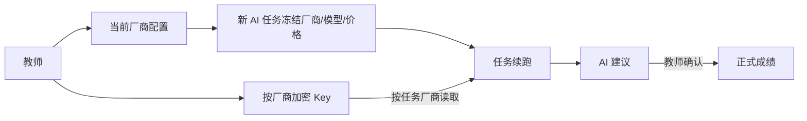

# 数据模型与迁移约定

> 2026-10-03正式1.30.26无表结构变更；`seat_helper_enable_http_20261003.sql`仅启用当前61所有效学校并为新配置填写HTTP根地址，已有地址不覆盖，设备与基准不自动生成。验收数据仅独立学校，已停用/撤销，真实成绩不变；详见 [助手验收](../../contexts/classroom-experience-20261002/seat-helper-release-verification-20261003.md)。

> 2026-10-03正式1.30.24已上线（v4.02），先前本机候选描述转为历史；四份课堂SQL及厂商密钥依赖已迁移，正式API13组/浏览器9组通过。118条历史状态未治理，助手保持关闭、机房待验。见 [正式验收](../../contexts/classroom-experience-20261002/release-verification-20261003.md)。

> 2026-10-03 v4.01本机修复候选：无新增表列。clearPracticalAnswer明确写submit_time=NULL；当前作品指针与WORKING专用撤回在同事务，普通状态上报不降级SUBMITTED。成绩Mapper新增submittedAnswerCount，空文件占位不产生待批；0分是有效评分。历史旧状态未批量治理，待只读审计。 证据与限制见 [修复验收](../../contexts/classroom-experience-20261002/repair-verification-20261003.md)，未正式发布。

## 2026-10-02 作品更新、个人反馈与可选机位（本机候选）

本轮只在新隔离库迁移并重复执行验证，目标环境需另行备份、迁移全部四份 SQL、配套发布前后端并重启。明细与回退见 [专题验收](../../contexts/classroom-experience-20261002/verification.md)。

| 数据 | 真源和约束 | 脚本 |
| --- | --- | --- |
| 当前作品与正式成绩 | 复用原作品版本/答案/任务状态；score NULL 表示未批，0 分已批；退回保留旧分，成功重交后当前待批，旧版本留分。流程图提交新增 `score_snapshot INT NULL`、`scoring_details_json LONGTEXT NULL` | `classroom_experience_flowchart_history_v1.sql` |
| 附件分类 | 既有 `biz_practical_attachment` CHECK 增加 TEXT/HTML/ARCHIVE；格式白名单仍由具体题目控制，不回填旧题、不开区域抽测 | `classroom_experience_attachment_kinds_v1.sql` |
| 学生个人反馈 | `biz_student_feedback_publication`：`(report_id,content_hash)` 唯一，记录教师/学校/课/题/班；`biz_student_feedback_snapshot`：`(publication_id,student_id)` 主键，源作品版本与本人 JSON 不可变。内容指纹包括输入、报告与排序后的个人结果，同内容发布幂等，结果变化必须新发布 | `classroom_experience_feedback_v1.sql` |
| 学校/设备 | `biz_seat_helper_school`：学校双开关的学校配置；`biz_seat_helper_device`：随机 device_id、机房机位、密钥哈希、机器指纹和撤销状态。注册锁学校行并当前读取有效机位，阻止并发重复注册；同机位已撤销记录保留 | `classroom_experience_seat_helper_v1.sql` |
| 长期常用机位 | `biz_seat_helper_binding` 主键 `(dept_id,room_name,entry_year,class_code,student_id)`，记录 device_id、确认教师与时间；事务锁当前指派、学校、基准行并复核观测。整班允许已确认互换，缺席/未知/重复与链式保留冲突不覆盖 | 同上 |

注册码、单次打开凭证、设备心跳和登录后观测保存在 Redis 有限 TTL 中，不把“在线”落成长久身份事实。教师拖动大屏卡片和改变班级分组不更新机位绑定。应用回退保留新增列/表和所有新作品/反馈，不反向清分或恢复整库覆盖新数据。

## 2026-09-23 本地增量：多厂商 Key 与画程尺寸

`biz_teacher_ai_provider_key` 以 `(teacher_user_id, provider_code)` 为主键，保存 AES-GCM 密文、末四位掩码和该厂商上次模型。`sql/operation_ai_multi_provider_keys_v1.sql` 幂等建表并用 `INSERT IGNORE` 迁入旧 `biz_teacher_ai_config` 中的当前配置；旧表继续表示当前选中厂商，不能用其密文续跑其他厂商的任务。任务行原有厂商、模型、价格快照不变；续跑从新表按任务厂商取 Key，缺 Key 明确失败。只在本机开发库和隔离克隆库验证，正式环境未迁移；必须保留原主密钥，应用与 SQL 配套更新。



画程沿用版本化 JSON，不加列、不回填作品。节点 `properties.width/height` 可选，旧节点仍按文字布局；普通图旧左右锚点在前端加载时映射为上下中线，判断菱形四点不变。结构判题忽略尺寸和布局；教师评分仍绑定提交版本。打字统计的可选 `grade` 由查询学年换算 `entry_year` 并同时限制学校学段，学校汇总和班级明细复用该条件，不落表。

本机克隆库的 DATA_LAB 旧题单缺不可变快照，`data_lab_v2.sql` 前检拒绝；为入口验收仅在该隔离库创建 v1 表和上传表，不能将其视为完整 v2 迁移。正式 130 在 1.30.23 已完成 v1/v2，未在本轮重新操作。

## 2026-09-22 DATA_LAB已正式迁移

130的1.30.23已备份执行v1/v2，config/submission/snapshot/upload四表及source_id非空、revision/max_score已核验。专用隔离库迁移重复执行、旧缺快照阻断、4并发提交单行、4并发克隆唯一草稿与序号、发布快照隔离均通过。下段“未迁移”为历史；回退应用保留实验数据，不恢复整库。

## 2026-09-21 DATA_LAB（本地代码，未迁移）

- biz_data_lab_snapshot以普通题单snapshot_id为主键，固定Excel路径/名称、说明、初始代码和满分；版本克隆复制，重加复用，不动态读取题库当前配置。
- biz_data_lab_upload记录UUID文件上传user_id归属；biz_data_lab_submission.student_id使用sys_user.user_id，与普通Python的学生档案ID必须转换。
- 提交唯一键来源非空，仅BASE_VERSION；revision重交递增，评分WHERE revision匹配，max_score取版本快照。
- 迁移顺序v1/v2；历史歧义拒绝自动迁移。当前代码的题单查询依赖新增表，未迁移不可部署。未进行真实MySQL迁移/并发验收，见ADR-014。

## 2026-09-21 分享令牌密文（130已备份迁移，1.30.21）

发布证据见PROJECT_CORE v3.92及output/share-grading-release/。正式教师页面与模拟批改回归通过；分享真实跨设备操作待教研员凭据补验。以下本机验证记录保留为历史。

`biz_research_topic.public_share_token_ciphertext` 为可空varchar(512)，AES-GCM密文与哈希同次更新，撤销清空两者；普通JSON忽略密文。执行 `sql/research_activity_public_share_ciphertext_v2.sql` 前备份，旧哈希不回填伪令牌，回滚代码可保留列。复用已有AI部署主密钥，恢复数据库需同时保留对应环境密钥。

## 2026-09-21 教研多附件（本机）

复用biz_research_resource的F类型行，一帖多行适用于COMMENT/MOMENT/RESOURCE，无表结构迁移。编辑锁父帖子，保留ID必须属于本帖有效文件；软删除移除行，事务提交后删除物理文件与预览缓存，回滚清理新增文件。L类型仍仅课程资源的云盘链接。Office预览PDF位于原私有文件旁的.preview目录，不新增公开静态路由。新旧客户端并存时，旧REPLACE/REMOVE语义仍为替换/移除全部附件，新接口支持逐个保留。详见research-activity/ADR-005-unified-attachments.md。

## 2026-09-20 打字重做及状态当前读（本机）

typing_redo_v1.sql新增biz_typing_redo_history，独立留存打字原答/分数/统计及题目快照；学生/课程/前轮唯一，最大redo_id作为typingRevision，与理论轮次分开。共用重做事务只删所选类型当前答案，打字新轮重新计分，同轮保留最高分；答案与GRADED同事务。旧请求受学生/指派锁和轮次校验保护。

BizStudentTaskStateMapper写入后用FOR UPDATE当前读，修复REPEATABLE_READ下并发同状态no-op写入后读空快照的问题，表结构和全局隔离未变。本机已备份、两次执行SQL、重启验证；新环境先建理论与打字两表，配套前后端；未迁移正式环境。证据及备份见contexts/theory-redo/tasks.md。

## 2026-09-20 理论重做（仅本机）

`sql/theory_redo_v1.sql`新增biz_theory_redo_history，保留教师/班级/学生/课程、前轮revision、原理论答案与题目JSON快照；(student_id,lesson_id,previous_revision)唯一，redo_id最大值作为新轮次。当前答案表仍只有当前成绩，重做只删除该学生该课的choice/judgment；typing/practical不动。归档、删除及RETURNED在一个事务；新理论答案及GRADED同事务。历史无对外查询接口。

本机已整库备份后执行两次，应用已重启；正式未执行。新后端current-lesson读取依赖该表，须先迁移再配套应用。回退可保留新增表，不自动恢复旧分。证据与备份见`contexts/theory-redo/tasks.md`。

## 2026-09-19 流程图几何与打字权限恢复（本机）

流程图1.0 JSON新增可选edge字段startPoint/endPoint、pointsList（2至100点）、sourceAnchorId/targetAnchorId、textPosition；坐标有限且在正负10000内，保留两位小数，text仍字符串供结构检查。复用现有JSON列，无DDL、不回填历史折点。BizStudentAnswerMapper当前题名单追加sys_user有效/未删除过滤。

`sql/restore_typing_statistics_permission_20260919.sql`补菜单2046下的旧stats按钮权限，只授予原本具有2046的有效researcher，保留监管权限。仅本机库已备份sys_menu/sys_role_menu后执行，幂等复核通过（26028）；正式尚未执行。备份摘要、回退边界见`contexts/five-issues-20260919.md`，不涉及业务数据迁移。

## 2026-09-18 学情 V3 独立数据

`sql/practical_insight_v3.sql`新增report（任务/输入/结果快照、Token、run_token）、paper_map（教师及材料指纹唯一）、student_evidence（报告/学生唯一、版本证据）三表。本机已备份并迁移，正式未执行。原成绩表不写入；报告输入绑定正式确认的当前作品版本、材料哈希、名单、年级、学科、模型及提示词。报告输入发生变化标过期，跨报告只复用相同教师/学生/指纹成功证据。取消后的旧worker不能更新新执行代进度/终态；供应商已返回usage仍累计。课程删除未做三表级联，历史报告因原scope失效不可访问，保留清理策略待定。

> 2026-09-06 中断交接：课程协作与固定组分离的 SQL 草稿为 `sql/collaboration_workspace_v2.sql`，新增快照存档版本、请求去重与分组用途字段。本机及正式库均未执行；部分本机 Mapper 已引用新列，源码未编译测试，不可直接发布到旧库。课堂固定组按班跨课程持久共用；协作按课程、班级和轮次保存，组数取所选文档数。详见核心上下文顶部和协作修复方案。

## 数据域

```mermaid
erDiagram
    SCHOOL ||--o{ CLASS : 包含
    CLASS ||--o{ STUDENT : 包含
    TEACHER ||--o{ LESSON : 创建
    LESSON }o--o{ CLASS : 指派
    LESSON ||--o{ QUESTION : 包含
    STUDENT ||--o{ STUDENT_ANSWER : 课程作答
    STUDENT ||--o{ STUDENT_TASK_STATE : 课堂任务状态
    LESSON ||--o{ STUDENT_TASK_STATE : 课程题目六态
    STUDENT_ANSWER ||--o| ORPHAN_ANSWER_ARCHIVE : 删题前审计归档
    AI_MODEL_PRICE ||--o{ AI_GRADING_JOB : 创建时冻结单价
    PYTHON_PLAN ||--o{ PYTHON_PLAN_VERSION : 版本
    PYTHON_PLAN_VERSION ||--o{ PYTHON_PLAN_CLASS : 投放班级
    PYTHON_PLAN_VERSION ||--o{ PYTHON_PLAN_QUESTION : 题目快照
    PYTHON_PLAN_VERSION ||--o{ PYTHON_SUBMISSION : 独立刷题提交
    LESSON ||--o{ COLLAB_ROOM : 按班协作
    LESSON ||--o{ IOT_EXPERIMENT : 物联网实验
    IOT_EXPERIMENT ||--o{ IOT_GROUP : 小组
    IOT_GROUP ||--o{ IOT_MESSAGE : 消息
    LESSON ||--o{ LESSON_TOOL : 本节课工具
    STUDENT_TOOL ||--o{ STUDENT_TOOL_SCOPE : 适用范围
    SCHOOL ||--o{ STUDENT_TOOL : 常驻工具(可选)
    QUESTION ||--o| FLOWCHART_QUESTION : 画程配置
    LESSON ||--o{ FLOWCHART_LESSON_SNAPSHOT : 冻结题目口径
    STUDENT ||--o{ FLOWCHART_DRAFT : 自动保存
    STUDENT ||--o{ FLOWCHART_SUBMISSION : 不可变提交
    STUDENT_ANSWER ||--o| FLOWCHART_SUBMISSION : 当前提交引用
```

## 关键约束

- 流程图 AI 结果的 `practicalVersionId` 目前承载流程图提交 ID，但学生提交列表同名字段被文件附件补全服务消费，不能直接将两者 COALESCE。应按题型匹配独立的 `flowchartSubmissionId`；当前历史提交关联风险及候选方案见 `contexts/flowchart-tool/ai-grading-investigation-20260907.md`（2026-09-07，未发布）。

- 表、字段、索引和菜单的最终定义以根目录 `sql/` 以及相关 MyBatis XML 为准。
- 所有迁移优先幂等，并带前检/后检；发布前必须对目标库备份，不能用本机结果替代。
- Python 独立表以 `biz_python_practice_*` 为主；课程答案仍在既有答题域。
- Python 专用题目标题、知识点、无输入标记、内容版本和验证状态保存在 `biz_programming_question_config`，不在统一题目表增加“适用场景”；课程用途由 `biz_lesson_question` 表达，刷题用途由题单版本关联表达。该配置表的可空唯一 `external_id` 只承载系统题稳定编号（如 `PYV2-001`），教师自建题为空。
- `biz_python_practice_plan_class` 以题单版本关联学校、入学年份和班级；同一范围允许多份题单。`entry_year` 的展示语义是“级”，当前自然年级由 7 月 20 日学年切换点和学校学段计算，不能直接显示成“届”。已发布题单修改时复制成新草稿版本，旧版本和快照继续服务既有学生，直到新版本发布。
- 题单删除一律物理清理完整依赖链，不保留 `ARCHIVED` 业务入口或恢复能力。旧 `biz_python_practice_extension*` 三表已退出查询链，正式库保留空表仅用于结构兼容。
- `biz_python_practice_submission_case` 保存独立刷题逐测试点结果；公开测试点可保存输出与错误摘要，隐藏测试点只保存状态、耗时、内存等脱敏字段。自定义运行的输入保存在刷题提交表 `custom_input`，不写课程答案或进度。
- 课程内 Python 自定义运行的输入保存在 `biz_programming_submission.custom_input`（仅 `submission_kind=CUSTOM_RUN` 使用）；逐点结果以测试点 ID 0 表达一次自定义执行。该记录不计分、不写 `biz_student_answer`，迁移脚本为 `sql/course_python_custom_run_v1.sql`。
- 题单快照保存题目标题、难度、知识点和无输入标记，已发布内容不因题库后续编辑而漂移。
- 普通 Python 题删除前必须检查课程、题单、快照、草稿、提交和进度依赖；无依赖时按“测试点 → 编程配置 → 统一题目”同事务删除。一次性 V1 退场使用经精确前检和整库备份的 `sql/python_practice_polish_v3.sql` 清理完整依赖链，不复用普通删除接口。
- Python 题的统一题目记录不承载年级、学期和课次，三个字段保存为空；题目创建人保存真实人员“郑东旭”，系统题来源使用编程配置记录的 `create_by=python-system-v2` 标记，二者不可混用。
- IoT 以 `biz_iot_*` 保存实验、小组、设备、消息与诊断，Broker 管理凭据不入业务表。
- 协作保留既有房间/版本资料，CryptPad 迁移只扩展 Provider 能力，不删除历史 WPS 回滚材料。2026-09-06 工作台迁移（`sql/collaboration_workspace_v2.sql`，正式已执行）：快照加 `round_no` 且唯一键改为一课一班一轮次；活动加 `request_id/request_hash` 去重并发保存；方案加 `scheme_scope` 区分固定组与历史协作来源（旧协作自动方案精确标记为 `COLLAB_LEGACY`，数据零删）。小组房间用负 `question_id` 命名空间避开旧全班房间的 `(lesson,question,dept,year,class)` 唯一键。
- 学生实验工具两类：`biz_lesson_tool`（本节课工具，随 lesson 去留）与 `biz_student_tool`+`biz_student_tool_scope`（常驻工具，scope 按 入学年份+班级，class_code 空=整个年级生效，dept_id 隔离学校）。学生端匹配：lessonTools 取当前课程 + residentTools 按 学校+年级+班级 匹配启用项。
- 题目开放开关：`biz_lesson_assignment.theory_open/practical_open`（班级x当前课程）。`advanceCurrentAssignment` 推进下一课时默认开放为 1（自动和手动一致，2026-09-14）；成绩页 `/business/score/lesson-gate` 读写。课程设计器的 `initialTheoryOpen/initialPracticalOpen` 默认均为开启；课程保存采用“先读旧指派→重建→回填”策略，已有班级保留旧值，仅新指派班级使用设计器提交值，避免重存课程覆盖课堂状态。
- 课程与 Python 题仍通过 `biz_lesson_question` 多行关联，不增加“一课一道 Python 题”唯一约束；合法性由全课程题目分值合计 100、题目启用和 `VALID` 状态共同约束。
- `biz_student_answer.student_id` 严格保存 `biz_student.student_id`，批改、成绩、学情、课堂聚合和画像 JOIN 都必须使用 `a.student_id = s.student_id`，不得与 `sys_user.user_id` 或 `biz_student.user_id` 混用。只有同时匹配当前 `biz_lesson_question(lesson_id, question_id)` 的记录才能进入批改、成绩、学情、截止进度和预览恢复等在线统计。课程保存移除题目时，必须在同一事务内把在线答案显式列复制到 `biz_student_answer_orphan_archive`，写 `biz_student_answer_orphan_archive_meta` 批次元数据并核对数量后，才能删除在线行和题目关联；归档失败必须回滚课程保存。
- `biz_ai_model_price` 保存模型输入/输出单价（元/千 token）、状态和说明；`biz_practical_ai_job` 保存新任务创建时的价格快照。任务理论费用只汇总 `biz_practical_ai_result` 已持久化的 token，用 `输入 token × 输入单价/1000 + 输出 token × 输出单价/1000` 计算，不等同于供应商账单。旧任务无快照时可引用当前价格，但必须在接口和页面标明口径。
- 画程迁移 `sql/flowchart_operation_v1.sql` 只新增四表：`biz_flowchart_question` 保存教师基础图/标准答案/权限/规则和配置修订；`biz_flowchart_lesson_snapshot` 按课程题目唯一冻结口径；`biz_flowchart_draft` 按学生课程题目唯一并以 `revision` 乐观并发；`biz_flowchart_submission` 保存递增版本、来源草稿修订、图文档、规则快照、检查证据和非正式建议分。现有 `biz_student_answer.student_answer` 只保存 `FLOWCHART:<submissionId>` 受控引用，正式分仍在原 `score` 字段。
- 流程图 AI 不新增成绩表或 AI 专用流程图表：`PracticalAiJob/Result` 复用普通文档操作题任务链，`PracticalAiResult.rubric_snapshot_id` 在流程图场景保存 `submission_id` 作为非空版本锚点；学生图和课程标准答案由服务端渲染为 JPG，JSON、结构检查和规则快照只作为模型辅助上下文。
- 画程文档真实数据为 `schemaVersion=1.0` 的平台 JSON；只保留四类节点、折线箭头、文字、坐标和受控锁定属性。PNG/SVG、LogicFlow 内部状态和未来 AI 结果都不是当前作品真源。
- 学生 Excel 导入的账号查重使用 `sys_user(user_name, del_flag)` 联合索引，迁移与回滚分别为 `sql/student_import_governance_v1.sql` 和 `sql/student_import_governance_v1_rollback.sql`。索引是普通索引，兼容同名历史软删除账号；有效账号唯一性继续由同校 Redis 导入锁、批量前检和写后数量核对共同保证。正式库已于 2026-09-01 执行迁移，前检有效用户名重复组为 0，迁移后 `EXPLAIN` 命中 `idx_sys_user_name_del_flag`。
- 一次学生导入中的 `sys_user`、`sys_user_role`、`biz_student` 和新增 `biz_teacher_class` 必须处于同一事务，按最多 200 条分批写入并核对影响行数；任何一段失败都必须回滚，禁止继续返回“部分成功”。允许在写库前排除格式错误、Excel 内重复和已有有效账号，并在结构化结果中分别计数。
- 学生安全处理复用既有状态字段：`sys_user.status` 为 `0=正常、1=停用`，停用不改 `biz_student` 及历史成绩；只有经 `StudentBusinessRecordMapper` 确认无答题及其他业务记录的学生才允许硬删除。批量纠错以 `student_id` 定位并原地更新 `user_id` 对应账号和档案，禁止删除重建。
- `biz_lesson.status` 为 `0=正常、1=已归档`，归档课程仍保留指派、答案和成绩，仅从日常课程查询中过滤；恢复通过课程状态接口完成。迁移脚本为 `sql/lesson_archive_status_v1.sql`，回滚脚本为 `sql/lesson_archive_status_v1_rollback.sql`。

## 2026-09-03 多功能改造数据模型状态

- `biz_student_task_state` 已完成本地领域类、Mapper、服务和迁移脚本，并已在本机及正式数据库执行；正式库回填 186,541 条，重复、非法、孤儿和部门错配均为 0。唯一键为 `lesson_id + question_id + student_id`；字段保存学校、六态 `task_state`、单调递增 `state_version`、`changed_at` 和审计时间。
- `sql/student_task_state_v1.sql` 会从当前课程仍引用的历史答案回填可确定的 `SUBMITTED/GRADED`，不猜测 `ENTERED/WORKING`；全班查询对无记录学生投影为 `NOT_ENTERED`、版本 0。回滚脚本为 `sql/student_task_state_v1_rollback.sql`。
- 课堂大屏不增加汇总表：`/business/classroom-state/summary` 以班级学生为基准，关联当前课程题目和 `biz_student_task_state` 实时聚合总题数、已开始题数、各状态题数及最后变更时间；座位、分组和 Presence 仍分别从其既有事实读取。
- 星级评分不新增成绩表字段，`NUMERIC/STAR_TOTAL/STAR_ITEM` 仅为请求契约；正式成绩继续写既有整数列。
- 本机及正式库均已执行 `sql/class_grouping_v1.sql` 与 `sql/group_collaboration_v1.sql`：通用分组、课时快照、教师班级布局、独立协作活动/任务版本/小组映射、协作会话事件和 revision 差异表已存在。小组协作不写 `biz_student_answer`，不复用物联网分组事实。详见 `contexts/online-collaboration/`。
- 分组方案的同名保存以 `scheme_version` 递增保留历史版本。课时快照生成须先通过课程创建者（管理员除外）、学校与课程班级指派校验；教师个人座位布局提交须精确覆盖当前班全体学生，禁止外班、重复或遗漏学生，且校验必须先于旧布局删除。
# 课程删除与物联网外键链路（2026-09-04）

`biz_lesson` 被 `biz_iot_experiment` 引用；实验下游还包括 `biz_iot_class_config`、`biz_iot_group`、`biz_iot_group_student`、`biz_iot_device`、`biz_iot_message` 和 `biz_iot_event`。课程物理删除必须在同一事务按“消息/事件、组员、设备、小组、班级配置、实验、课程关联、课程”的顺序清理，不能依赖数据库级联。当前实现已在 `IotMapper` 与 `BizLessonServiceImpl` 接入该顺序，并随 `20260904_codex_perf_release` 正式发布；真实课程删除回归仍建议在专用验收课程上补测。
# 2026-09-17 纸质导入方案 A 数据增量

无新增业务表或数据库迁移。教师代交复用 PracticalArtifact、Version、Attachment 及原学生答案/评分明细；提交人使用已有字段，纸质来源使用服务端专用附件目录。Redis 保存 24 小时身份导入凭证和 7 天学情报告，凭证绑定教师/范围/首次确认学生；报告按正式成绩内容指纹失效。`sql/paper_scan_v1.sql` 是废弃草稿，不执行。暂存文件由专用目录清理任务回收，不清理正式作品。


## 2026-10-05 机位助手自动关联（正式1.30.27）

复用原学校/设备/基准三表，无新列或结构SQL。同校机器指纹查询及设备密钥轮换在学校行锁内；数据库成功提交才写Redis结果。配对300秒、结果120秒，随机轮询证明和设备密钥仅服务端/本机保存，浏览器不能领取。正式验收临时学校停用、作品和一条基准保留审计。 证据、限制与下一步见 [正式验收](../../contexts/classroom-experience-20261002/seat-helper-auto-verification-20261005.md) 和 [ADR-004](../../contexts/classroom-experience-20261002/adr/ADR-004-student-zero-config-seat-helper.md)。

## 2026-10-06 学校动态查询优化

只改LoginPreviewMapper聚合顺序：90天活动先按lesson_id/student_id取MAX，再以学生实际学校/年班匹配唯一scope，保持COUNT DISTINCT和使用时间排序。原非空答题及当前题目批改条件保持；无结构或索引迁移。正式同一快照旧新6行逐字段一致，证据见[性能验收](../../contexts/login-showrooms-20261005/performance-verification-20261006.md)。

## 2026-10-07 查询修复（无结构迁移）

推进和班级成绩人数对操作题复用成绩汇总事实：非空答案、已有成绩或有效版本指针；空占位不计入。理论/打字和独立课堂表现规则保留。图片SQL同时约束主题、学校、作者有效性。机位候选机房并集包含本班历史已确认基准，设备改归属不自动搬移基准；管理员注册码在学校锁内拒绝同指纹有效设备重复注册。未治理历史重复设备与空作品状态。见 [复核记录](../../contexts/bug-review-20261007.md)。
