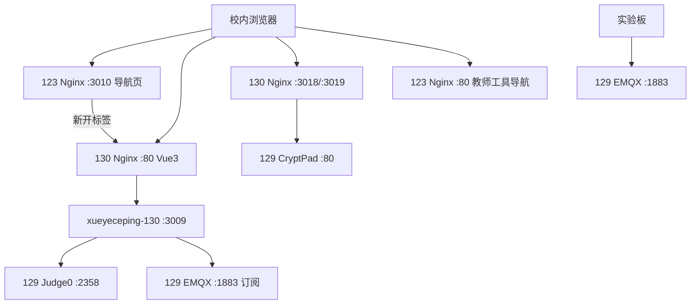

# 部署与回滚约定

## 2026-09-21 130正式1.30.21

release=/data/apps/xueyeceping/releases/20260921_share_grading_v1，08:51:01 COMPLETED。备份=/data/backups/xueyeceping/20260921_share_grading_v1，database.sql为221147539字节，SHA-256 ca1c16b2624f47fb82209620501bac68b823c821df8443147c3e67a26db5f2e7。备份后执行research_activity_public_share_ciphertext_v2.sql并核验varchar(512)。主密钥及环境文件不变，三服务active；JAR SHA-256 8fa2ad28bfda016d6e108cfe4e022b6f20c6f159b2dec51235c24d004df8585d，index SHA-256 7858e3f9a80a59c294910617d0803409ccc91cd38c8aed77b5af464cfd1c54b6。

回滚先检查活动AI任务，再恢复备份service.before和nginx.before到原systemd/nginx配置路径，daemon-reload、重启后端、nginx -t成功后reload，退回20260921_research_ai_full_v1/1.30.20。保留新增列、所有release和新成绩；不恢复整库、不旋转主密钥。撤回时将1.30.21更新记录转DRAFT。当前update_id100为PUBLISHED且真实教师可见。正式批改模拟回归通过；分享跨设备真实操作待补验，证据output/share-grading-release/。


## 2026-09-20晚130学情与整班PDF发布（09-21验收收口）

正式版本1.30.19，release为`/data/apps/xueyeceping/releases/20260920_insight_batch_pdf_v2`，09-20 23:58:06 COMPLETED。基于130原1.30.17隔离移植11个后端源码对应35个class和3个前端模块，未混入其他本机改动；123的1.30.18未动。v1先验证36份报告，完成后v2补轮询主键更新与真实updatedAt；两次切换前均确认AI批改/学情活动任务为0。

最终JAR SHA-256 `b7c1167a11aef6ce0f7a13b0e9d824ca03c1ada1119a7c4394bd2eaf00216b51`，index SHA-256 `4e416e4fc5a5b4f365963c9396b61983650a193a270f3fa305a7fc68a9ada048`。后端/Nginx/aiot-lamp均active，环境文件哈希保持；无业务迁移/新配置/密钥变更，已重启后端。仅SQL `sql/insight_batch_pdf_release_20260920.sql`登记1.30.19/update_id98为PUBLISHED，真实教师list接口可见。

v2整库备份`/data/backups/xueyeceping/20260920_insight_batch_pdf_v2/database.sql`，217403433字节，SHA-256 `c5e39d8f4a2c956756c62d5b622c6bb5be73b4a76a210109d201b1f36a9c48c8`。同目录保留service.before/nginx.before/env.before/config.before及原jar。v1之前备份`/data/backups/xueyeceping/20260920_insight_batch_pdf_v1/database.sql`，216422743字节，SHA-256 `b11e0e914a2830778bd108c096bf78092e7cd4e13004dfa9da2ac49f1bae90fa`。

回滚须先检查并结束当前活动任务。恢复v2备份的service.before到`/etc/systemd/system/xueyeceping-130.service`及nginx.before到`/etc/nginx/sites-available/xueyeceping-130`，daemon-reload、重启后端、nginx -t后reload，可退回v1；v1仍有旧轮询死锁缺陷。若需完整退回本轮之前的1.30.17，同样恢复v1备份内两个配置，指向20260920_redo_export_fixes_v1。保留所有release和新报告，不恢复整库覆盖新成绩，无业务回滚SQL；撤回功能时只把对应1.30.19更新记录转DRAFT。

证据`output/yueling-insight-release-v2/deploy-result.json`、`final-read-result.json`、`input-comparison.json`、`teacher-version.json`及原目录online-result.json/pdf-online-result.json。正式报告4完整715秒、36有效/0失败、覆盖85.71%，仍PARTIAL（21人局部待核对）；成绩未变。72页拆36份测试未提交学生作品。不能把全班运行完成当作人工准确率验收。

## 2026-09-20 123路由开机自动维护（当前方案）

整机重启后接口编号33→44，旧123/32路由缺失，学校/24持久项仍在。现在由SYSTEM任务 `Codex-123-WireGuard-Route` 在开机和每分钟执行 `C:/ProgramData/CodexNetwork/123WireGuard/Ensure-123WireGuard.ps1`，按名称jiaoyuju及WireGuard类型动态识别接口，补ActiveStore的123/32、NextHop=0.0.0.0路由。该目录ACL仅SYSTEM和Administrators可写，Users只读执行；不能改成执行用户可写脚本。

备份及任务配置在同目录 `routes-before.json`、`task.xml`，当前结果 `status.json`。16:54:43重启WireGuard服务后123主机路由消失，16:55:39任务记录repaired=true，随后普通连接收到SSH-2.0-OpenSSH_for_Windows_7.7。初始restart-test.json只记录了重启开始，不能单凭该文件声称整个测试完成；完成依据为status.json和随后普通TCP复核。整机再重启尚未实测，启动触发器已配置；隧道启动后约一分钟恢复。未设置隧道关闭时禁止直连的防火墙。

仅维护123主机路由，学校10.52.1/2/3三个/24、DNS、NRPT和WireGuard配置保持。无服务端变更或产品版本。安装/检查脚本位于 `output/full-release-20260919/Install-123WireGuard.ps1`、`Ensure-123WireGuard.ps1`。回滚以管理员执行同目录 `Uninstall-123WireGuard.ps1`，先禁用/停止/注销该任务，再删除当前WireGuard的123直连主机路由；保留备份目录，不删除学校路由。下文固定IF33持久路由为历史，勿再次按旧编号执行。

## 正式发布更新记录门禁（2026-09-20修正）

130正式部署验收成功后，必须自动登记 `contexts/RELEASE_LOG.md` 并发布对应 `biz_platform_update` 记录为PUBLISHED，再以真实教师身份调用 `/business/platform-update/list` 验证版本可见。已授权部署无需另行询问更新记录发布；只有用户明确要求暂不公开才可保留DRAFT。失败或回滚候选不得标成已上线。

本轮经123跳转130，备份表后执行 `sql/publish_verified_release_notes_20260920.sql`，仅将92～96对应1.30.12～1.30.16从DRAFT改为PUBLISHED，保留内容和原发布时间。教师接口及页面验证通过；无需打包或重启。其他历史草稿不变。

表备份 `/data/backups/xueyeceping/20260920_publish_release_notes/platform-update.sql`，33581字节，SHA-256 `28b297313ace411e38cd10fde4b1a32c9447aae2ff8690bc444e53b6aeb32018`。需撤回时仅精确恢复上述五条的原状态及审计字段，不整表覆盖后续新增记录。证据 `output/full-release-20260919/published-notes.json`、`published-notes.png`。

## 2026-09-20 本机访问123默认走WireGuard

当日后续复查：此前123/32活动和持久项均缺失，原因未定。再次管理员执行下述route命令后，两表均存在且普通未绑定接口TCP连接源地址10.99.1.8，收到123的SSH握手；指定校园网仍超时。不得只凭脚本COMPLETED判断成功，必须现场检查两表及普通连接。未重启隧道/电脑验证，未新增定时任务或修改WireGuard配置，不能把本次恢复视为丢失根因已修复。

用户授权修改全局网络配置，已通过管理员 `route.exe -p ADD 10.52.1.123 MASK 255.255.255.255 10.99.1.8 METRIC 1 IF 33` 添加持久主机路由。活动表显示123/32在jiaoyuju接口33上On-link，持久表网关10.99.1.8。普通未绑接口TcpClient源地址为10.99.1.8，成功收到123 SSH响应。其他校园网路由、NRPT及WireGuard配置未改，访问其他服务器仍按123跳转约束执行。

该状态取代下文“仅为发布连接指定隧道”的本机配置现状。WireGuard需开启；未通过重启电脑或隧道验证持久项恢复，若隧道地址变化须重新核对。未设置隧道断开时阻止校园网回落的防火墙规则。

回滚：管理员执行 `route.exe DELETE 10.52.1.123 MASK 255.255.255.255 10.99.1.8`，再检查活动及持久路由表，确保只删除本次123/32项。操作脚本及状态在 `output/full-release-20260919/set-123-route.ps1`、`route-123-status.txt`。本轮无线上应用发布、SQL或服务器重启。

## 2026-09-19 1.30.16全量发布

当前130前后端统一为 `/data/apps/xueyeceping/releases/20260919_full_insight_fixes_v1`。独立完整构建包含课堂五项修复、学情V3.3.1及已核查的既有热修；不是class替换包。用户已明确授权全量上线。执行入口 `output/full-release-20260919/deploy_release.py`，独立systemd任务完成，`status.py`可只读查询；不得重复执行创建同名release。

正式外置config复制旧后端版本，服务使用 `--spring.config.additional-location`，正式库仍ry-vue、上传仍/data/upload。保留migration-isolation.env及共享env，后者仅新增PRACTICAL_INSIGHT_ENABLED=true，原主密钥及其他值比对不变。SQL只执行practical_insight_v3.sql、restore_typing_statistics_permission_20260919.sql及版本登记full_insight_fixes_release_20260919.sql；废弃paper_scan_v1.sql未执行。

备份目录 `/data/backups/xueyeceping/20260919_full_insight_fixes_v1`，整库203301601字节，SHA-256 `f3a24b70b5b67bfbafe5c9fc8ece82a786a8a54ad042d5cb5cf8c2d38fd45b4f`，已核对dump完成标记。保留旧JAR、config、unit、Nginx及env。新前端额外保留旧static文件供已打开页面加载。

回滚前确认当前仍是本release并取消正在执行的学情任务，恢复service.before至 `/etc/systemd/system/xueyeceping-130.service`、nginx.before至 `/etc/nginx/sites-available/xueyeceping-130`、env.before至 `/data/apps/xueyeceping/shared/xueyeceping-130.env`，然后daemon-reload、restart xueyeceping-130、nginx -t、reload nginx，检查3009/captchaImage和/prod-api/captchaImage。后端回到20260917_ai_apply_home_fix_v1，前端回到20260918_classroom_gate_fix_v1。保留诊断三表与权限，无需回滚SQL，不用整库恢复覆盖新成绩。切换脚本在失败时执行同样回退并探活。

网络：09-18 WorkBuddy新增10.52.1.0/24→10.52.27.254校园网持久路由后，默认及网卡21连接123:22超时；09-19 socket指定WireGuard网卡33并bind10.99.1.8成功。`transport.py`仅为该SSH连接选择隧道并核验123/130固定主机指纹，严格123跳转130，不直连130。未改系统路由、NRPT或WireGuard配置；网卡编号或地址变化时应重新核对，不能盲用常量。

正式三角色页面和API通过；真实学情报告1完成1份，前后正式成绩不变；版本1.30.16已写DRAFT/update_id96。证据、构建日志、manifest、截图及SQL后检位于output/full-release-20260919。真实登录故障接口及37/13原班级未定位，不能把部署完成等同现场根因已查清。

## 2026-09-18 1.30.15课堂开关显示热修

正式130前端root已切 `/data/apps/xueyeceping/releases/20260918_classroom_gate_fix_v1/frontend`，后端仍使用20260917_ai_apply_home_fix_v1，unit/JAR哈希和PID252438保持不变。仅平滑reload Nginx。原域名真实郑老师课程574和郑东旭课程575分别观察约70秒、3次状态查询保持开启，无pageerror。前端5项、推进服务5项测试及Vue3构建通过；真实业务班级未执行推进或关闭操作。正式原JAR推进SQL已在MySQL临时表验证双开及范围隔离。

制品基于下载的活动前端，仅替换课堂开关读取/旧请求保护函数。为避免浏览器缓存，JS模块加gate0918后缀并同步模块引用和gzip文件，旧资源保留；本机AI学情V3未打入正式包。制品清单及脚本位于 `output/gate-fix-20260918/`，首页SHA-256 `d528fd675bd6baca7a5147c82084aa17ba5ccca0d96f49920770d1c1dc80fb63`。

整库备份 `/data/backups/xueyeceping/20260918_classroom_gate_fix_v1/database.sql`，196418043字节，SHA-256 `ec908ae46a551d59d5002b3ddb0c35acbe5842d92f63af5f009387aea748795f`；同目录保留nginx.before/service.before，status=COMPLETED。仅执行发布登记 `sql/classroom_gate_fix_release_20260918.sql`，1.30.15草稿95，无业务迁移。

回滚：先确认当前root仍是本release，再将该备份nginx.before恢复到 `/etc/nginx/sites-available/xueyeceping-130`，执行 `nginx -t` 和 `systemctl reload nginx`。无需切后端、恢复整库或跑回滚SQL。已打开的页面需刷新加载修复版；学生/教研员页面未专项重测。

## 2026-09-17 1.30.14采用与首页热修

当前130为 `20260917_ai_apply_home_fix_v1`，原 `20260917_paper_ai_v2` 保留。前轮线上JAR仍有待核对拦截；本轮只替换已测服务及其匿名内部类两个class，并核验包内字节等于target/classes，不能只比外层JAR哈希。前端批改页恢复单根节点并修正0采用提示。14项测试、构建和真实教师页面通过，任务28唯一建议正式写入52分且审计完整。

备份目录 `/data/backups/xueyeceping/20260917_ai_apply_home_fix_v1`，database.sql为193967886字节，SHA-256 `754e3c8a222419712c7d8ec0ff4c508a9fb5bddf684c83b1644541fb2aa32fe3`。状态COMPLETED；三服务active；JAR `1c799176984647b61e07681992c0d24188ed85bf0ab2dc4887753505bdb77836`，首页 `a08cb534a49f1fe03be8010c3195b9fe5189e5ff67cf0a7c0c5e865afbe0503f`。证据output/ai-apply-fix-20260917。

回滚：确认当前仍为本release，恢复该备份service.before到/etc/systemd/system/xueyeceping-130.service、nginx.before到/etc/nginx/sites-available/xueyeceping-130；执行systemctl daemon-reload、restart xueyeceping-130，nginx -t后reload nginx并探活。无表结构变更和业务回滚SQL，不恢复整库覆盖采用后的成绩。登记SQL为sql/ai_apply_home_fix_release_20260917.sql，1.30.14草稿update_id94。

## 2026-09-17 纸质AI发布1.30.13

当前130 release为 `/data/apps/xueyeceping/releases/20260917_paper_ai_v2`，旧版 `20260916_iot_subscribe_fix_v1` 保留。沿用130的固定SSH指纹、systemd独立发布任务及失败自动回滚；根scripts/deploy.py仍针对123 Windows，不可直接用于130。执行证据在 `output/ai-paper-release-20260917/`。

状态COMPLETED，后端、Nginx、aiot-lamp均active。JAR SHA-256 `b5dedf9df98875a04e4dc8ce50892542bf5a11b8abe2ac01699753bd0898dff3`；首页 `d591f192f2374e61697c6a6390ffc8d8be6bd2bff399ca5e8fa64d4e27700a16`。Nginx重载后需重试首页哈希，等待worker切换；v1曾在后端已启动后校验失败并自动回滚，精确失败步骤当时未记录。

备份 `/data/backups/xueyeceping/20260917_paper_ai_v2` 含整库database.sql（193937386字节，SHA-256 `4a15eb4ff0d67cb45a2964882f3d56bb0672fa3d0ac7a217b804daf805dae365`）、service.before、nginx.before、env.before、原JAR和config.before。未变更shared环境或业务表；仅运行发布登记SQL，1.30.13 DRAFT/update_id93。不得为应用回滚恢复整库覆盖发布后的成绩。

需回滚时，在130确认当前仍为v2后恢复本次备份的unit与Nginx配置，再执行以下命令（需sudo）：

```bash
cp -a /data/backups/xueyeceping/20260917_paper_ai_v2/service.before /etc/systemd/system/xueyeceping-130.service
cp -a /data/backups/xueyeceping/20260917_paper_ai_v2/nginx.before /etc/nginx/sites-available/xueyeceping-130
systemctl daemon-reload
systemctl restart xueyeceping-130
nginx -t && systemctl reload nginx
```

等待后端启动后验证3009及80/prod-api/captchaImage、旧首页哈希及三服务状态；无需业务回滚SQL，保留更新草稿用于审计。禁止轮换AI主密钥。

> 2026-09-16 19:10：130当前release为 `20260916_iot_subscribe_fix_v1`，基于线上JAR仅替换两个物联类、移除废弃Decision类。data订阅补齐、平台自动下发取消。service/nginx/env/整库备份在 `/data/backups/xueyeceping/20260916_iot_subscribe_fix_v1`；回滚命令见 `contexts/junior-iot-poc/ADR-004-original-data-subscription.md`。ACL独立回滚，不应因应用回滚再次取消data订阅。详见PROJECT_CORE.md v3.65。


## 拓扑



2026-09-09 21:05：学业测评入口是 `http://10.52.1.130/`。协作大门已改到 `10.52.1.130:3018/3019`（反代 129 CryptPad）。123 的 `NewDaziBackend3009` 已停止；3010 为导航页；123:3018/3019 暂留回滚。物联网接收器在 130，设备仍连 129:1883。`xxkj.xsedu.net.cn` 尚未切到 130。

## 发布不变量

1. 先读取真实服务器配置、服务状态和目标库状态；历史文档只作线索。
2. 先备份目标库及相关 Nginx/NSSM/外置配置，记录非敏感校验信息。
3. SQL 仅执行仓库 `sql/` 中通过前检的相关脚本；完成后做存在性和重复数据复核。
4. 后端、前端必须发布到新的 release 目录，保留旧 release；不得直接覆盖活动版本。
5. 切换后执行构建/单测、服务探活、关键 API，UI/权限变更再做 Playwright 冒烟。
6. 汇报必须注明当前 release、回滚路径、是否需回滚 SQL、未完成门禁；不得输出凭据。

## 一键发布执行器（2026-09-07）

统一入口为仓库 `scripts/deploy.py`，远端执行引擎为 `scripts/release-engine.ps1`。入口先用固定 SSH 指纹连接 10.52.1.123，再在服务器创建 SYSTEM 计划任务，因此本地 SSH 断开不会中断发布。任务状态写在 `D:/program/3009dazipingtai/deploy-jobs/<jobId>/state.json`，远端不会记录密码、Token 或原始异常。

执行顺序固定为：inspect → check → deploy。deploy 会校验新 release 清单，复制外置 config，备份整库、Nginx 配置、NSSM 参数与 SHA-256，然后先切后端并通过数据库登录、协作健康、共享网关检查，再切 3010 前端并复核首页哈希。后端停止采用服务级 WaitForStatus，超时直接失败，不按名称强杀 Java；任一切换后的健康检查失败会自动恢复旧 AppDirectory、日志路径、Nginx 配置并再次探活。`rollback` 只接受备份目录位于正式 backups 下且当前 release 匹配的请求。

调用示例和制品清单要求写在根目录 `AGENTS.md` 第 9.1 节；本机回归 `python scripts/test_release.py` 覆盖成功、哈希不匹配、备份失败和健康失败四条路径。该执行器不会主动执行业务 SQL；需要迁移时仍按本 runbook 的前检、备份、增量脚本和后检顺序单独操作。

## 当前正式基线（2026-09-02）

- 版本：`1.28.3`，后端继续使用 `releases/20260901_scheme2_score_numeric_v1/backend`，3010 前端切换至 `releases/20260902_student_entry_year_grade_v1/frontend`；学生管理入学年份会按当前校区学部自动显示当前年级备注。
- 1.28.3 为前端精确发布：小学显示 `x年级`、初中显示 `初x`、高中显示 `高x`，筛选和保存值保持纯入学年份。无后端或表结构变更。发布前整库备份：`D:/program/3009dazipingtai/backups/20260902_student_entry_year_grade_v1_before/ry-vue_before.sql`，SHA-256 `9661D33CF475A2C67A80F08CB60AC257059FA95A29DF17659FE63F81106EDC3C`；平台更新 `1.28.3` 已登记为 `PUBLISHED`（update_id=68）。3009、3010、`/prod-api`、80、3012 均 HTTP 200，`UnifiedNginx` 为 Running。回滚：将 Nginx 3010 root 切回 `releases/20260902_student_correction_upload_hotfix_v1/frontend` 并重启 `UnifiedNginx`；无需后端或结构 SQL 回滚。
- 1.28.2 为前端精确热修：线上学生模块重命名为 `student-correction-upload-hotfix-20260902.js` 并替换 6 处引用；后端未重启、无业务数据或结构变更，正式上传大小限制仍为 10MB。
- 发布前整库备份：`D:/program/3009dazipingtai/backups/20260902_student_correction_upload_hotfix_v1_before_retry/ry-vue_before.sql`，SHA-256 `7CBBD9CF7BF6BB06C9EB63E2063B0E3CE817D7FB201A1DB70F12CF4887C7B8E9`；NSSM/Nginx 配置、前端包与 SQL 同目录保留。
- 平台更新 `1.28.2` 已登记为 `PUBLISHED`（update_id=67）；3009、3010、`/prod-api`、80、3012 均 HTTP 200，`UnifiedNginx` 最终为 Running。
- 回滚：将 Nginx 3010 root 切回 `releases/20260901_score_numeric_sort_hotfix_v1/frontend` 并重启 `UnifiedNginx`；数据库无结构 SQL，仅按版本精确撤销平台更新记录。
- 1.28.1 为前端热修：修复 Element Plus `sort-method` 回调参数误用，课程成绩列改用 `sort-by`；后端未重启、无业务数据变更。
- 发布前整库备份：`D:/program/3009dazipingtai/backups/20260901_scheme2_score_numeric_v1_before/ry-vue_before.sql`，SHA-256 `61BDC6848D01CADC46BB0672CF453FBBC3DD67AEC6AD9220AC7D4F34993D6364`；NSSM/Nginx 配置同目录保留。
- 本轮执行 `sql/lesson_archive_status_v1.sql` 与 `sql/platform_update_scheme2_score_numeric_v1.sql`；`biz_lesson.status` 存在，平台更新 `1.28.0` 为 `PUBLISHED`（update_id=65）。
- 正式库已新增普通索引 `idx_sys_user_name_del_flag(user_name, del_flag)`；正向和回滚脚本分别为 `sql/student_import_governance_v1.sql`、`sql/student_import_governance_v1_rollback.sql`。
- 回滚：导入备份中的 `nssm-before.reg`、恢复 `nginx.conf.before`，重启 `NewDaziBackend3009` 并重启/重载 `UnifiedNginx`；数据库新增归档字段可兼容保留，平台更新按版本精确改为草稿或删除，禁止物理删除历史成绩。
- 小学实验板 MQTT 精确 ACL 和同步状态已在 v1.27.2 完成；v1.27.3 将学生端 Python 页签设为默认，v1.27.4 将复制代码修正为 N17 的 `npython + oled.print` 格式。初中 Mind+ 兼容入口保持不变。
- 对应发布证据、备份哈希和正式验收见 `contexts/PROJECT_CORE.md` 第 26 至 31 节与 `contexts/RELEASE_LOG.md`。

## 外部服务注意事项

- Judge0、CryptPad、EMQX 是独立部署单元，不能因部署其中一个而重启或改写另一个的卷、网络、端口。
- Judge0 当前容量基线：123 `ruoyi.judge.core-pool-size=10`、`max-pool-size=10`、`queue-capacity=1000`、`judge0.class-concurrency=60`；129 `COUNT=10`、`MAX_QUEUE_SIZE=512`，server 2 CPU/2GiB，worker 10 CPU/16GiB。配置变更必须按 50/100/200/400 阶梯验收。
- 129 回滚只恢复 `/srv/judge0-python/backups/<批次>/` 中的 compose/conf 并重建 Judge0 server/workers；不得顺带停止 PostgreSQL、Redis、CryptPad 或 EMQX，更不得删除卷。
- 123 本机实测 `nssm restart NewDaziBackend3009` 可能停在 `SERVICE_STOP_PENDING` 后留下 `Stopped`。发布脚本应显式 `stop` → 等待状态变为 `SERVICE_STOPPED` → `start`，并在 3009 探活 200 后再继续；NSSM 路径统一用正斜杠，避免 PowerShell/Python 反斜杠转义破坏参数。
- CryptPad 当前内网 HTTP 状态不是正式安全验收；必须明确标识。
- EMQX 与平台 MQTT 接收器的启用是两个独立步骤，均需实测后记录。

## 教师工具统一网关（2026-08-31）

正式主机 `10.52.1.123` 的教师工具入口统一由 D 盘 Nginx 服务 `UnifiedNginx` 提供。活动配置唯一入口为 `D:/programsoftware/nginx/nginx-1.29.4/conf/nginx.conf`；该服务自动启动并监听 80、3010、3012。C 盘 `OpenResty` 已停止并禁用，旧 D 盘 Nginx 计划任务已禁用，禁止再向 C 盘配置或旧计划任务写入变更。

| 外部路径 | 内部目标 |
| --- | --- |
| `/tools/mail/` | `127.0.0.1:3002`（HTTP.sys） |
| `/tools/primary-lab/` | `127.0.0.1:3003` |
| `/tools/network/` | `127.0.0.1:3020` |
| `/tools/iot-data/` | `127.0.0.1:3006` |
| `/tools/image-recognition/` | `127.0.0.1:3001` |

3006 由 NSSM 服务 `TeacherToolIotData3006` 管理，自动启动并配置异常自动重启。教师工具数据库地址必须使用上述 80 端口路径，不应要求教师直接访问 3001/3002/3003/3006/3020。修改网关时先备份并在 D 盘 `conf` 目录生成候选文件做 `nginx -t`，切换后确认 80/3010/3012 均由 `UnifiedNginx` 同一进程树监听。

## 2026-09-07 登录恢复候选（未发布）

用户要求先修本地，再由用户重启服务器，收到完成消息后代理部署。候选和逐类差异位于 `output/online-recovery-20260907/`；后端基于活动JAR定向替换，前端完整构建。必须重新核对活动基线SHA，复制外置config并保留旧release；无业务SQL，不清空Redis。发布后真实角色验收，并登记RELEASE_LOG及平台更新记录。不要将冷重启后的恢复误认为14:17前的连接重置、LibreOffice故障已根治。

2026-09-07本轮最新状态：候选已上传至20260907_online_recovery_v1，用户选择手动执行该目录switch-release.ps1（管理员PowerShell），可加-Rollback切回旧版。新旧Nginx候选及哈希已验，尚未切换。代理不得因上传完成宣称已发布，发布后再登记版本与正式验收。


2026-09-14：当前 full_local_v1/config/application.yml 已补 MQTT 管理配置，备份 /data/backups/xueyeceping/iot-config-20260914_105340/application.yml.before。未重启，PID/探活正常；用户允许空闲窗口后仅重启 xueyeceping-130，再重试班级同步。切 release 必须携带配置。回滚恢复该文件，无 SQL。


2026-09-14 后续状态：用户授权后已仅重启 xueyeceping-130，PID168090，首页/API/代理均200，EMQX管理API及授权源正常。外置配置已随启动加载，取代此前待重启状态；失败班级重试同步与硬件收数仍待验证。未打包部署或Git推送。见 PROJECT_CORE.md v3.60。
## 2026-09-21 1.30.20 正式发布

130 已切换至 `20260921_research_ai_full_v1`，原版本为 `20260920_insight_batch_pdf_v2`。发布无业务 SQL，保留外置配置与共享环境哈希。备份位于 `/data/backups/xueyeceping/20260921_research_ai_full_v1/`，数据库备份 SHA-256 为 `ab0cb2417d72f98239adebaa20dc4b1ffdf01714c5315adba64e7250728fffd9`。

回滚：确认无活动 AI 任务后恢复该目录的 `service.before`、`nginx.before`、`env.before`、`config.before` 和旧 JAR，执行 daemon-reload、重启后端、`nginx -t` 后 reload，回到 1.30.19；不覆盖新成绩、不执行业务 SQL 回滚，1.30.20 更新记录转 DRAFT。
