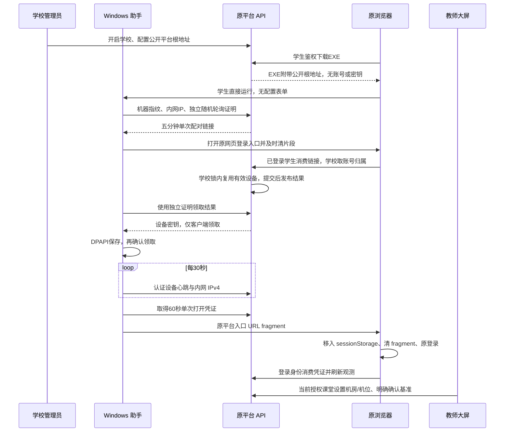
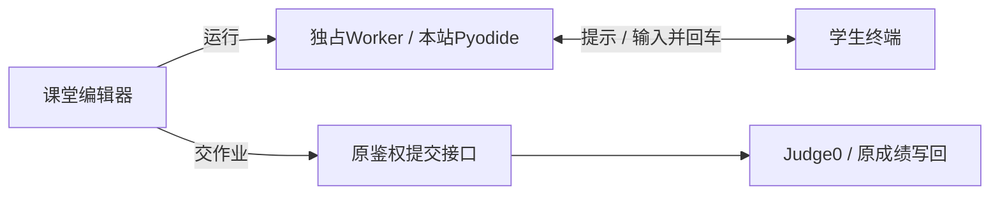
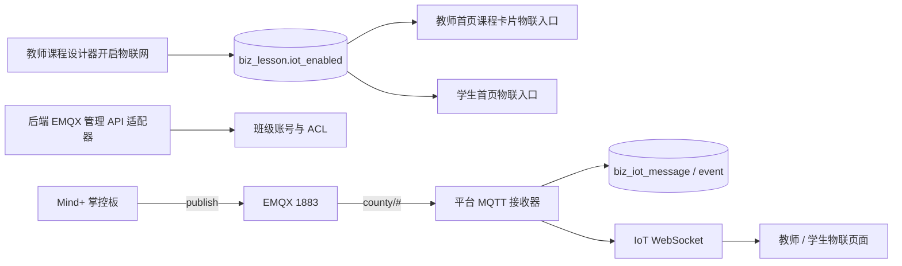

# 外部协议与实时链路

## 2026-10-15PPTX临时副本兼容（130正式1.30.51）

公共FileConversionUtils在既有DOCX预处理后调用PptxPreviewNormalizer；已知PPTX直线/二至五段折线按保存几何展开成只读普通路径，保留负调整值和变换，避免Impress重新布线。短单行输入输出框在严格条件下禁止自动折行。未知形状保持原转换，原件身份/毒文件/隔离进程保持；PDF继续交既有页图v4，无新依赖、配置或渲染器版本变化。反馈四班40份已备份后重算成功，其他缓存不自动刷新，见[设计与边界](../../contexts/pptx-preview-fix-20261015/design.md)。

2026-10-20按授权完成朱仁敏2022级2班三题108份旧PPTX预览重算（首批37份、补批71份），以正式渲染器逐份从新PDF生成新页图地址，避开旧哈希/浏览器缓存；原件、分数与版本保持，无部署/重启。各批鉴权接口及真实教师样本浏览器通过，三班未处理，判断框换行及浅色连线仍有差异，见[验收与回退](../../contexts/ppt-connector-diagnosis-20261020.md)。

## 2026-10-29机位助手0.2.6与网页版本兼容（已随1.30.61/1.30.63发布）

正式1.30.60前端 `probeLocalSeatHelper` 写死只接受助手 `0.2.3/0.2.4`，而配套发布的助手已是0.2.5，导致已装0.2.5的电脑网页一律显示“机位未关联”（塔山教师反馈）。修复：前端改为按最低版本0.2.3比较（`helperVersionAtLeast`），新增`npm run test:seat-helper`并纳入`build:prod`；助手0.2.6默认安装目录改为`C:\SchoolSeatHelper`（同传/还原通常只覆盖C盘），不可写时回退当前用户LocalAppData，同机首次运行会把旧D盘或用户目录的`seat-helper.dat`/`platform-url.txt`迁移到新目录并保留原目录；回环探测版本号统一取`AppVersion`常量。本机前端构建与发布校验通过、产物已无写死白名单；客户端53项回归通过。前端最低版本修复已随1.30.61发布，助手0.2.6已随1.30.63热替换下载文件（默认C盘，真实学生下载哈希与站点块已验）；真实学生认领复验仍待。

## 2026-10-28机位最新登录优先（本机修复、未发布）

教师反馈换账号后学生卡片仍显示旧电脑内网 IP。新增 `latest:{studentId}`（最新登录标记，TTL 7200）：只有最新登录能写/清 `student:{id}` 与认领设备，旧登录返回 `superseded` 且不消费票据；最新会话退出后立即让位。`liveStudentDevice` 要求 `latest` 与 `owner` 均匹配本次登录，`owner==null` 不再放行。大屏无 IP 时不再显示「未连助手」，状态保留在悬浮提示。单测与双端构建通过，未发布、未做真实助手换账号复验；详见[专题](../../contexts/seat-ip-login-order-20261028.md)。

## 2026-10-17机位静默与默认浏览器优先（130正式1.30.52）

助手0.2.4通过回环TCP所属进程识别浏览器、Windows HTTP默认程序优先。设备认证的open票据携带浏览器归属/75秒优先权，学生只提交单次token；后端学校行锁串行仲裁，status不回写owner，非默认浏览器不反抢。安装包允许明确的域名/IP清单，普通启动默认静默。无结构SQL或新依赖，三端已配套发布并重启；旧版须退出后安装一次。正式证据及回退见[验收](../../contexts/seat-score-release-20261017.md)，协议边界见[专题](../../contexts/seat-helper-browser-20261016/tasks.md)，不影响作品/成绩权限。

## 2026-10-14机位回环认领（130正式1.30.50）

助手0.2.3以127.0.0.1:28123/identity提供精确Origin允许的短期单次凭证，HttpListener因URLACL拒绝时同端口TcpListener兼容，不要求学生提升权限。浏览器不取得设备secret/proof；/student/claim-local复用当前学生/学校/撤销与凭证消费校验，网页自报IP/deviceId不作为认证。新MAC指纹由持旧密钥的/device/upgrade-identity升级并保留设备ID。学生800ms探测、10秒续期/未关联2秒重试，大屏5秒REST校准；服务端75/90秒TTL保持，Presence连接IP只留诊断，不显示为机位地址。

新浏览器LNA权限与HTTP安全上下文仍需机房验证，CORS不能保证零浏览器权限框。130已迁移两列并发布0.2.3，教师/教研员通过，真实学生认领仍待有效正式凭据；协议、真实测试边界及回退见[专题设计](../../contexts/seat-helper-local-20261014/design.md)、[验收](../../contexts/seat-helper-local-20261014/verification.md)。

## 2026-10-14正式1.30.49

后端 `20261014_seat_logo_overflow_v2`、助手0.2.2，前端保持1.30.48。页框扩展与Logo已发布；反馈班级44份success/v4且原件成绩版本保持，但样本内部A4整页clip仍截断底部，尚未解决。常量升级必须同步两处编译期内联消费者，不能只换渲染器class；外置config与隔离env仍引用20261008旧release。制品差异、两次短暂重启、备份哈希、下载/教师验收与回滚见[正式记录](../../contexts/seat-logo-overflow-release-20261014.md)。

## 2026-10-13 连线题转换正式 1.30.45

Office 六通道 → 公共 FileConversionUtils → 可确定环绕原点的 DOCX 临时副本（两分支页面坐标）→ 既有共享池/隔离进程 → PDF / page-jpeg-v3 版本目录。原件与毒文件身份仍使用原路径，临时副本在转换结束后清理；未知布局保留原转换。无新依赖或配置，57 项测试、49 份本机样本验证通过；130 于 19:13:52 探活，25 份旧图全部重算成功，新页图 API 可读，原件/成绩/版本保持，真实教师可见 1.30.45。Linux 既有字体分页及未修正连接符显示差异仍存在，未通过本轮横坐标修复解决。规则、范围与回退见 [专题设计](../../contexts/connector-render-fix-20261013/design.md) 与 [验收](../../contexts/connector-render-fix-20261013/verification.md)

> 当前正式1.30.27（2026-10-05）：客户端0.2.0学生直接运行自动读取IP，原网页登录确定学校，教师设置名称并确认。正式配对/DPAPI、重复关联、撤销及98秒Python续期通过；下面较早记录为历史。见 [自动关联验收](../../contexts/classroom-experience-20261002/seat-helper-auto-verification-20261005.md)。

> 2026-10-03正式1.30.26：用户要求HTTP可用，助手全局及61校已开启；客户端0.1.2与服务端允许HTTP/HTTPS根地址，注册码/设备/会话/长期基准规则保留。网页30秒续期不依赖首页，正式Python页面超过98秒仍关联；撤销/未安装/学校关闭不影响正常教学。HTTP不加密，按学校可信网络使用；机房自启/还原仍待现场。见 [当前事实](../../contexts/PROJECT_CORE.md) 与 [助手验收](../../contexts/classroom-experience-20261002/seat-helper-release-verification-20261003.md)，下面默认关闭为历史阶段。

> 2026-10-03正式1.30.24已上线（v4.02），先前本机候选描述转为历史；四份课堂SQL及厂商密钥依赖已迁移，正式API13组/浏览器9组通过。118条历史状态未治理，助手保持关闭、机房待验。见 [正式验收](../../contexts/classroom-experience-20261002/release-verification-20261003.md)。

> 2026-10-03 v4.01本机修复候选：学生布局承担30秒网页机位续期（服务端90秒TTL不变）；身份变化/卸载终止旧轮询。注册响应添加公开platformUrl；客户端0.1.1-pilot使用独立公开根地址缓存降级，不含设备密钥或关联token。接口异常/损坏配置7项通过，真实Win10/极域/还原卡仍待验。 证据与限制见 [修复验收](../../contexts/classroom-experience-20261002/repair-verification-20261003.md)，未正式发布。

## Windows机位助手（2026-10-05自动关联）

新部署默认 `seat-helper.enabled=false`，正式全局及61校已开启。自动配对300秒，领取结果120秒，保存后确认；日常打开凭证60秒且单次消费，片段不得进入登录redirect查询。管理员人工注册码30分钟仅高级兼容入口使用。设备TTL75秒、学生观测TTL90秒，服务端核对真实登录UUID；长期基准存MySQL，由教师明确确认，Redis保存短期观测，不用IP作为设备主键。重复配对复用同校有效电脑和教师命名，撤销电脑不能自动恢复。

学校现有HTTP/HTTPS根地址均支持，不要求先配置HTTPS。学校配置网页根，不带 `/student/index`；下载包只附公开入口，客户端自动推导 `/prod-api`，学生无需填地址。后端 `seat-helper.client-path` 指向真实EXE，Linux可分发Windows程序；HTTP无传输加密。助手关闭/断线不影响原网页登录与教学。

客户端无新增平台依赖，C#/.NET Framework 4 WinForms；HKCU Run 是当前 Windows 用户登录后的启动，不是未登录时系统服务。网页不能自动下载到 D 盘或运行 EXE；极域只分发程序，逐机凭据不复制。DPAPI 密钥、桌面/注册表自启和机器标识需纳入该校还原基线，D 盘保留不足以保证自启。真实 Windows 10/极域/还原卡/镜像克隆待现场小范围验收；当前 EXE 未签名。详见 [安装与撤销说明](../../clients/seat-helper/README.md)、[ADR-003](../../contexts/classroom-experience-20261002/ADR-003-optional-seat-helper.md)。

> 2026-09-16 19:10 修正：当前为原 data Topic 发布/订阅，平台不再判定命令或自动下发。130 已切 `20260916_iot_subscribe_fix_v1`；真实班级账号原 Topic SUBACK 128→0、跨班仍128，28项测试通过。真机及登录后页面待验；见 PROJECT_CORE.md v3.65 和 junior-iot-poc/ADR-004-original-data-subscription.md。以下相冲突的自动下行记录仅为历史。

## Judge0

2026-11-02课堂交互运行（已随1.30.66发布130）：课堂“运行”改用已有本站Pyodide基础库，在独占Worker内用JSPI/run_sync等待`input()`；“交作业”仍经原后台Judge0计分，浏览器不直连Judge0、不持有服务凭据。独立Python题单、DATA_LAB及旧RUN/CUSTOM_RUN接口保持。执行/输入/加载超时分离，切题和停止销毁线程。需新版浏览器JSPI能力；Worker不等于安全沙箱，本机输出不作计分依据。无SQL、配置、新依赖或后端重启，前端回滚可恢复原界面。见[设计及风险](../../contexts/python-interactive-20261102/design.md)。

- 调用方向：平台后端 → Judge0，浏览器不直接请求 Judge0。
- 配置：`JUDGE0_*` 环境变量；令牌只在私密部署配置。
- 用途：Python 课程题与独立刷题共用判题客户端、异步执行、限流和结果脱敏。
- 失败处理：服务关闭或不可用时，保留提交状态并反馈服务错误，不能写零分替代。
- 生产容量（2026-08-23）：400 份提交可同时落库并进入排队链路，123 判题执行器为 10 核心线程 / 10 最大线程 / 1000 队列，课程并发门限 60；129 为 10 个真实 worker、Judge0 队列 512。这里的 400 是排队容量，不是 400 个并行沙箱。
- 已验收：50/100/200/400 四档单用例 `CUSTOM_RUN` 均 100% 接收且全部 Accepted；400 档接口 P95 约 1.01s，接口接收后约 22.2s 排空。浏览器仍不持有 Judge0 地址或令牌。
- 共享主机边界：129 同时承载 CryptPad 与 EMQX，Judge0 worker 限额 10 CPU / 16GiB；继续增大 worker 前必须复跑阶梯压测并同步验证另外两项服务。
- Python 零基础 V3（2026-10-13）：`PYV3-001`～`PYV3-100` 沿用 Python 3、UTF-8 Base64 和标准输入输出协议，不依赖文件、网络、外部库或随机数；正式 Judge0 逐测试点 **340/340 Accepted**（公开 100、隐藏 240，每题权重合计 100）。题包先做数据维护，后随 130 正式 1.30.46 发布 V3 自动推荐、出题人筛选和 HTML 作业放大预览；Judge0 服务、容量和配置未变，也未自动创建学生题单。

## CryptPad

- **2026-09-09 方案 A**：服务仍位于 129，浏览器只访问 **130**。主入口 `http://10.52.1.130:3018`，沙箱 `http://10.52.1.130:3019`（130 Nginx 反代 129:80，Host 分别为 office / office-sandbox）。`frame-ancestors` 允许 `http://10.52.1.130` 与 `http://xxkj.xsedu.net.cn`。123:3018/3019 仅留回滚，旧垫作废。`/cryptpad/` 子路径代理仍不可用。双人打开与全县教育网 ACL 待现场复验。

- 调用方向：Vue3 编辑页加载 Integration API；平台后端签发受限会话并保存平台侧房间/版本。
- 身份：平台生成稳定参与者 ID，显示名不暴露内部 ID；OnlyOffice 参与人列表由 `users[nId].name`（成员表名字）优先，本地 `integrationConfig.user.name` 仅作兜底——该修复通过服务器侧 `patches/inner.js` 只读挂载覆盖容器内 `/cryptpad/www/common/onlyoffice/inner.js` 完成，改镜像/重建容器时不得丢失挂载。
- 当前协议限制：内网 HTTP/WS 仅作临时验收，恢复可信 HTTPS/WSS 后才可作为正式安全结论。
- 验收重点：同班访问、跨班/跨校拒绝、多人编辑、刷新保留、保存回调和版本递增。
- P3 小组扩展在平台侧按课时快照将每个小组映射到独立房间副本。学生会话只允许本人快照小组房间，记录进入、30 秒心跳、离开和保存事件；保存后的相邻 revision 结构摘要通过 `conversionExecutor` 异步提取，失败只写审计结果。保存触发者不是全部内容作者。
- 协作轮次已支持多版本快照（`round_no`）与请求去重；开始前调整直接替换未开始轮次，开始后新建轮次并归档旧轮次为只读。固定组（`scheme_scope='FIXED'`）与历史协作来源（`COLLAB_LEGACY`）已在数据层隔离。真实多人、多文件、断线恢复与容量验收仍待教师真实班级复验。

## EMQX / MQTT

- Topic 规范：`county/{schoolId}/{courseId}/{classCode}/{experimentId}/group{groupId}/data`。
- 账号策略：同班共享班级账号和易读课堂口令；Broker ACL 限制班级前缀，班内再按业务 Topic 隔离。
- 课程级开关：物联入口按 `biz_lesson.iot_enabled` 控制（教师设计器开启、考勤课强制关闭），教师/学生首页与接口均按此过滤；学生概览与教师收集接口还要校验课程已开启。
- 生产现状（2026-08-21）：EMQX 5.8.8 @ 10.52.1.129；1883 设备接入；管理 API 18083 已开放给内网（原仅 127.0.0.1），平台后端经 `dazi-backend` API 密钥同步班级账号；平台接收器 `IOT_MQTT_ENABLED=true`，以 `platform_iot_subscriber` 订阅 `county/#`；ACL 文件规则：订阅账号只读订阅 county/#、`class_*` 设备收发、device01 测试、deny all。
- 小学实验板兼容验证（2026-08-31 已通过）：真实板可直接导入 `umqtt.simple.MQTTClient`，显式设置 ClientID、用户名、密码和完整 `county/.../data` Topic，省平台 `userId/projectId` 封装不是技术依赖。实验板经临时账号 `primary_board_probe` 直连正式 EMQX，并于 `2026-08-31 09:19:19` 向精确授权 Topic 发布 JSON；平台接收器成功映射实验 1 / 小组 45，生成消息 8966 与 `MESSAGE_RECEIVED` 事件 9025。由此确认“真实小学实验板 → 129 EMQX → 123平台接收器 → 正式数据库”链路闭环；教师页面可视验收不属于本次服务器侧证据。
- 小学接入正式实现（2026-08-31，release `20260831_primary_iot_v1`）：`biz_iot_class_config` 已增加 `broker_sync_status`、`broker_synced_at`、`broker_sync_error` 三列；后端仅在账号与精确 ACL 同步成功后向教师/学生返回可运行口令和 Python 配置，失败时保留脱敏状态并支持教师重试。正式库 8 条班级配置均为 `SYNCED`；EMQX 内置数据库授权源已启用并按班级回填精确 ACL，`class_* → county/#` 宽规则及临时探针账号已删除。IoT 相关测试 15/15、Vue3 生产构建和正式 MQTT 本班/跨班/订阅隔离验收均通过。
- 学生端入口修复（2026-08-31，release `20260831_primary_iot_student_python_v2`）：小学实验板 Python 页签默认打开并提供一键复制本人小组代码；初中 Mind+ 参数页签继续保留，后端协议和权限不变。
- 开关：平台接收器由 `IOT_MQTT_ENABLED` 外置开启，默认关闭；启用前必须验证 SQL、Broker API、订阅账号、ACL 和真实硬件链路。
- 禁区：学生浏览器不持有 Broker 管理凭据，不能把旧 SIoT 共享弱账号作为多校正式方案。
- 运维路径：129 的 SSH 只经 123 跳板访问；小学实验板临时 ACL 修改前备份为 `/srv/emqx-school-poc/backups/20260830_050321_before_primary_board_probe/acl.conf`（SHA-256 `6e7df6236dcb759e08831542b40f6124eb3ccb7207bea0644293944454ab37f3`）。回滚时删除临时认证账号、移除对应单 Topic 文件规则；不重启 Judge0、CryptPad 或平台服务。
- 接收器保护：默认关闭；启用后同时受全局每分钟消息上限（默认 5000）、单 Topic 每分钟上限、Topic 长度上限（默认 256）及通配符/控制字符校验约束。上线前仍须结合 Broker ACL 和真实硬件链路复核容量。
- 启动行为：接收器在开关开启时通过 `threadPoolTaskExecutor` 异步连接 Broker，避免不可达 Broker 阻塞 Spring 主线程；连接失败写入诊断事件，默认关闭时不建立连接。
- 课堂口令密钥：`IOT_PASSCODE_SECRET` 只允许由部署环境注入，源码和配置文件不提供默认值；缺少密钥时不允许生成/轮换口令或导出课堂配置卡。生产已注入的密钥与历史默认值一致，保证既有密文可解；更换密钥必须先把存量密文全部重加密。学生概览接口还必须校验 `lessonId` 是本人班级当前指派课程。

## WPS 历史回调

- WPS 路线已退役，回调 Controller 保留兼容代码但默认由 `WPS_WEBOFFICE_ENABLED=false` 独立门禁阻断；只有协作总开关和该开关同时开启才允许进入业务层。CryptPad 是当前协作 Provider。

## WebSocket

- 导学单、课堂和 IoT 均为后端 WebSocket，不以浏览器直接连 Broker 代替。
- 改动时同时验证 Origin、握手身份、课程/班级范围、断线重连和跨房间隔离。

### 2026-09-03 Presence 规划与课堂任务状态

- 学生桌面已接入独立受认证 Presence WebSocket，学生登录后的公共布局连接；30 秒心跳、60 秒 Redis TTL 离线，不逐心跳写 MySQL。
- 连接 IP 由服务端从可信代理链观察。后端直连时不采信客户端伪造的转发头；仅当连接来自本机 Nginx 回环地址时，才读取 `X-Real-IP` 或 `X-Forwarded-For`。普通浏览器不能保证读取真实局域网 IP 或计算机名；经过 NAT 时允许多个终端显示同一出口地址。
- 班级管理仍保留“学生桌面”入口；教师首页课程卡片新增“课堂”入口，先选择已指派班级后打开课堂监控大屏。该状态不写签到考勤。
- 课堂任务状态核心链已在本地实现：现有课堂 WebSocket 保留三段兼容路径，并增加带 `lessonId` 的四段路径；学生只可订阅当前课程，教师历史课程订阅还要校验课程班级关系和管理范围。
- 状态事件统一为版本化 `TASK_STATE_UPDATE`：主业务事务提交后才以独立事务写状态，该状态事务提交后才发布；状态失败只告警，批改页按版本丢弃旧消息、合并刷新并每 10 秒 REST 校准，教师首页也每 10 秒校准操作题状态。课堂大屏另每 10 秒调用 `GET /business/classroom-state/summary` 获取全班真实任务汇总；相关增量 SQL 已在正式库执行并完成后检。
- 该课堂任务连接不能替代 Presence：它只服务课程房间与作业状态，不持有终端 TTL、连接 IP 或多设备聚合。

### 2026-09-04 上线前性能纠偏（已正式发布）

- Presence 汇总使用 Redis `SCAN` 一次枚举 `classroom:presence:*` 后按学生分组，禁止在学生循环中调用 `KEYS`；学生端断线重连采用指数退避和随机抖动，页面销毁后不再重连。
- 课堂大屏答案聚合查询在派生表内先按课程过滤，并配套 `sql/classroom_overview_perf_v1.sql` 的幂等联合索引；正式环境已完成备份、前检、执行和后检。
- 协作心跳不属于可审计操作事件，不写操作轨迹表；轨迹读取最多返回最近 500 条，避免无界结果集。
- 详细契约和容量门禁见 `contexts/class-grouping-and-desktop/ADR-001-server-observed-presence-and-class-entry.md` 与 `contexts/multi-feature-upgrade-20260902/design.md`。

## 2026-08-21 验收口径（覆盖 2026-08-20）

- CryptPad `/checkup/` 与基础 API 可达只证明服务探活；当前 HTTP/WS 明确是临时验收态，不代表正式传输安全，也不替代同班多人、刷新恢复和保存版本递增验收。
- Judge0 根地址可达但接口受鉴权保护；没有可用隔离令牌时不得绕过鉴权开展并发压测。
- EMQX：平台接收器已在正式环境启用并连上 broker（订阅 county/#）；内置数据库班级账号、精确 ACL、订阅账号和管理 API 密钥均已配置生效，跨班发布与订阅拒绝已验证。教师收集页、小组统计、双板 10 分钟到达率和断网恢复仍待真实课堂试点。

2026-09-14：130 消息端口和 EMQX 管理 API 均正常，built_in_database 已启用。补齐当前 release 的 iot.mqtt.emqx-api-url/key/secret（凭据引用现有环境变量），尚未重启后端、未验证班级恢复。单有 IOT_EMQX_API_KEY/SECRET 环境变量不能替代 application.yml 的属性映射。本地已补映射，未来发布必须保留外置地址。

2026-09-14 后续状态：用户授权后已仅重启 xueyeceping-130，PID168090，首页/API/代理均200，EMQX管理API及授权源正常。外置配置已随启动加载，取代此前待重启状态；失败班级重试同步与硬件收数仍待验证。未打包部署或Git推送。见 PROJECT_CORE.md v3.60。

## 2026-10-07 机位恢复补充（本机）

教师面板首次失败仍重试，切班与卸载清理唯一轮询；学生状态异常保留上次信息并标待核对，不冒充未关联。整批确认继续拒绝陈旧观测，失败后自动刷新；不改变75/90秒TTL或真实设备授权。详情见 [复核记录](../../contexts/bug-review-20261007.md)。

## 2026-10-08 自动安装与还原基线（本机待发布）

机位助手0.2.1为本机候选：优先D盘安装并从安装目录运行，当前Windows用户HKCU Run自启，快捷方式与自启独立核验，手动启动显示安装与关联结果。设备凭据、指纹和平台配对协议不变；无新依赖/SQL。程序目录、Windows自启与DPAPI/机器环境须纳入还原基线，现场重启未验。正式仍0.2.0，发布需替换下载制品并核对实际配置路径。详见clients/seat-helper/README.md。

## 2026-10-08正式1.30.37机位显示与助手0.2.1

上方同日“本机待发布/正式仍0.2.0”已由此次发布取代。130 release `20261008_seat_install_v1`，JAR字节不变，助手下载路径切换并重启后台，三服务active；只执行产品更新SQL，更新115 PUBLISHED且教师可见。教师课堂/学生首页和实际下载通过；机房自启及还原基线仍需现场重启验收。备份哈希及恢复service/nginx/env的回滚步骤见 [正式验收](../../contexts/seat-install-release-verification-20261008.md)。
