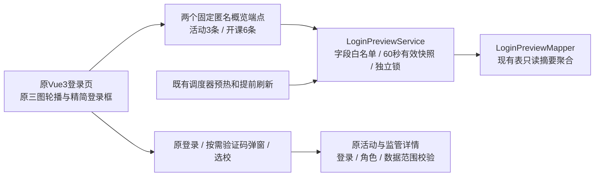
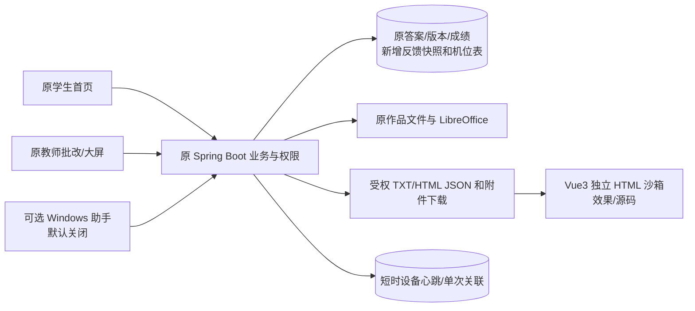
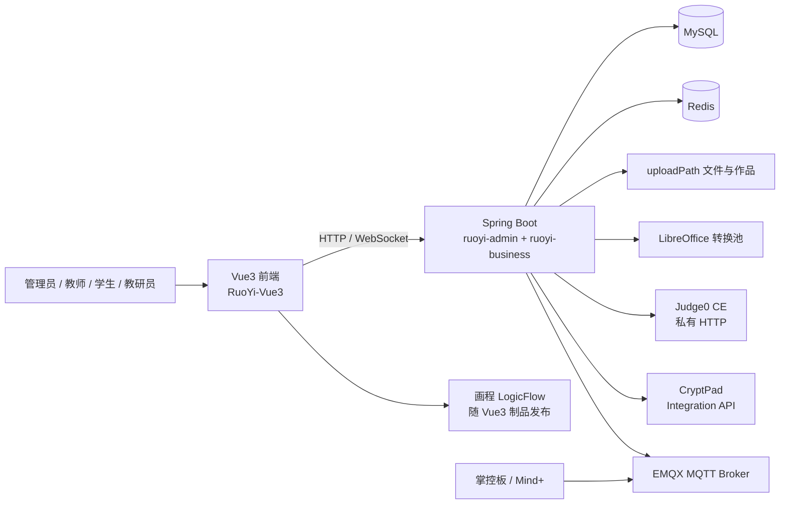
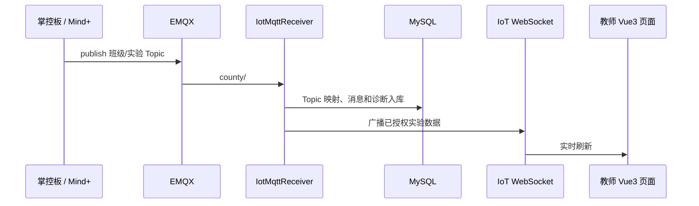

# 系统架构

## 2026-10-05 登录概览增量（正式1.30.28）

不放开内部Controller或复用含正文/成绩的内部VO；不新增数据库表或依赖。页面概览不包含学生身份、具体成绩、资源地址或详情ID。正式已配套发布双端并重启后端，共享环境与机位助手保持；规则及证据见[设计](../../contexts/login-showrooms-20261005/design.md)及[正式验收](../../contexts/login-showrooms-20261005/release-verification.md)。

> 2026-10-03正式1.30.26已启用可选助手（61校），复用现有HTTP平台/API与Redis；独立客户端不成为登录/作答前置条件。无HTTPS/新依赖/表结构要求，正式注册、关联、跨页续期及无助手作答通过，机房现场分发仍待完成。当前以 [PROJECT_CORE v4.05](../../contexts/PROJECT_CORE.md) 为准。

> 2026-10-03正式1.30.24已上线（v4.02），先前本机候选描述转为历史；四份课堂SQL及厂商密钥依赖已迁移，正式API13组/浏览器9组通过。118条历史状态未治理，助手保持关闭、机房待验。见 [正式验收](../../contexts/classroom-experience-20261002/release-verification-20261003.md)。

> 2026-10-03 v4.01本机修复候选：学生布局提供机位会话，首页组件只展示；异步结果由身份/课班/学校键及请求代次约束。作品删除→清答案/版本→专用任务撤回→事务提交后广播；反馈、成绩及导出共享未提交事实。架构与依赖不变。 证据与限制见 [修复验收](../../contexts/classroom-experience-20261002/repair-verification-20261003.md)，未正式发布。

## 2026-10-02 课堂体验增量（本机候选）

没有第二套登录或新教学入口：作品更新仍走原版本/事务，学生个人反馈在首页打开，教师在原报告抽屉整班发布；长期机位只作为原大屏的核实信息。TXT/HTML/压缩包不进入 LibreOffice/图像 AI，旧预览保持。客户端是按学校选择的独立 Windows 程序，不是后端必须安装的常驻依赖。五张新业务表和历史字段需配套迁移，即使助手关闭也需先建表；明确迁移、配置与未验现场边界见 [交付报告](../../contexts/classroom-experience-20261002/verification.md)。

## 组件关系

## 代码分层

- `ruoyi-admin`：应用启动、资源配置和聚合依赖。
- `ruoyi-business`：业务 Controller、Service、Provider、异步任务、WebSocket、MyBatis Mapper 和业务测试。
- `ruoyi-framework`、`ruoyi-system`、`ruoyi-common`：RuoYi 基础能力、认证、权限、缓存与通用工具。
- `RuoYi-Vue3/src/api`：前端 API 封装；`views`：角色和业务页面；`router`、`permission.js`：前端路由与守卫。

动态路由、Spring 注入、MyBatis XML 和反射会让静态调用图不完整。因此排查端到端链路必须至少核对：前端 API → Controller → Service → Mapper XML/SQL → 权限校验 → 单测或接口证据。

画程的 LogicFlow 仅是 Vue3 内嵌图编辑底座，不是独立服务，也不拥有课程权限或作品真源。教师配置、课程快照、学生草稿、正式提交、结构检查和成绩确认均由 `ruoyi-business` 与 MySQL 承担；浏览器离线备份只用于防丢和冲突恢复，不能绕过服务端修订号与交卷事务。流程图预览只返回学生基础图和不泄露答案的配置完成状态；课程设计器与课程快照均拒绝半成品或无法规范化的旧配置。流程图文字安全校验由前后端共同执行，服务端是最终边界。流程图 AI 批改复用普通文档操作题任务队列：服务端把学生提交和课程标准答案 JSON 渲染为图片，视觉模型以图片为主要依据，JSON/结构检查作为辅助上下文，建议分只有教师确认后才进入正式成绩。

## 真实时间链路

## 2026-10-05 机位助手自动关联（正式1.30.27）

Windows客户端自动识别机器与IP；学生从鉴权下载包获得公开入口，原浏览器登录决定学校，原服务完成设备登记和配对。教师设置名称和显式基准。未新增服务、依赖或第二套账号。 证据、限制与下一步见 [正式验收](../../contexts/classroom-experience-20261002/seat-helper-auto-verification-20261005.md) 和 [ADR-004](../../contexts/classroom-experience-20261002/adr/ADR-004-student-zero-config-seat-helper.md)。

## 2026-10-07 本机补充

登录页现有匿名图片代理保留，统一源数据有效性检查；待选校Cookie只恢复前端选择流程，不承担授权。流程图预览按名单版本读取，草稿冲突显式选择后重取revision。机位单轮询不依赖首次成功，布局响应合并概览状态。无新依赖、表或服务；见 [复核记录](../../contexts/bug-review-20261007.md)。
